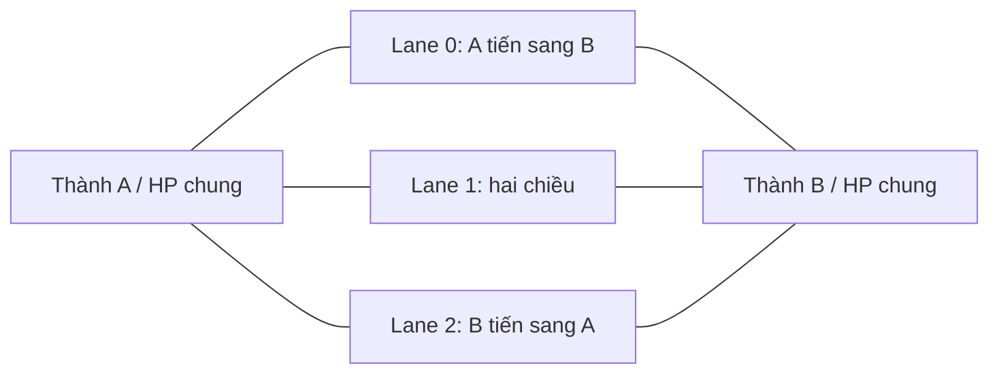

# Battlefield và vòng lặp

## Luật có nguồn

Whitepaper tr.3–5 xác nhận 1v1 thời gian thực, ba lane nối hai thành, quân tự tiến và đánh đối tượng đầu tiên vào tầm; thành không tự bắn. Quân đến cuối lane đánh thành, HP thành dùng chung và trận kết thúc khi HP về 0. Tài liệu nói không hòa nhưng không công bố tie-break khi hai thành cùng hết HP. Khoảng trận 1–3 phút là mô tả thông thường, **không** phải hard timeout. [Castle Crush Whitepaper v2.1](https://castle-crush-crypto-bucket.s3.amazonaws.com/whitepaper/Castle%20Crush%20Whitepaper%20v2.1.pdf).

Diagram là logic, không phải scale đo đạc. Hình battlefield trong whitepaper tr.4 nhìn ngang: A trái, B phải, ba đường xếp theo chiều sâu. Không dùng ảnh quảng cáo nhìn từ sau lưng quân trên Google Play để suy camera chiến đấu.

| Tham số | Dữ liệu | Độ tin cậy |
|---|---|---|
| Số lane | 3 | Confirmed historical |
| Chiều dài/rộng, đơn vị world | `null` | Unknown |
| Vùng triển khai | Wiki nói tiến theo quân, tối đa giữa sân; spell có vùng khác | Unverified live; [nguồn](https://castle-crush.fandom.com/de/wiki/Karten) |
| Thành con/tower phòng thủ | Không thuộc mô hình hai thành tr.5 | Không nhập cơ chế tower của Clash Royale |
| Giao lane | Có thẻ nhiều lane theo wiki; đổi lane/range ngoại lệ chưa đo | Phải đặc tả từng ability |
| Overtime | Bắt đầu sau 4 phút; tự gây damage thành tăng dần | Confirmed support; hàm damage và cadence `null` |

Nguồn overtime: [Wildlife](https://wildlifestudios8986.zendesk.com/hc/en-gb/articles/12694401083537-Overtime). Thuật toán đề xuất phải dùng `overtimeCurve` cấu hình, không tự coi linear/exponential là luật gốc.

## Thời gian và kinh tế trận

Whitepaper tr.5 ghi regen 0.5 mana/s, tăng 1 mana/s sau 45s; capacity khởi đầu 2, tối đa 12. Tr.4 ghi draw 7–10s trong khi tr.5 ghi 7s. Support tách **mana hiện có** và **crystals**; không giải thích initial draw có tính vào crystal hay double-card trigger không. Các con số lịch sử được lưu làm candidate, không đóng cứng thành số liệu hiện hành.

Support xác nhận bắt đầu tay 5 lá, tối đa 6, rút đồng thời hai bên; lá rút khi tay đầy bị mất; shuffle sau mỗi bộ 14; tay rỗng cho phép trả 5 mana rút thêm. [Draw/cycle](https://wildlifestudios8986.zendesk.com/hc/en-gb/articles/12684698308625-Card-drawing-and-deck-cycling).

Support mô tả double cards sau 5 lần rút, tay 5 chỉ nhận thêm 1; chưa rõ lá thứ hai có bị burn hay không tiêu thụ deck cursor. [Double cards](https://wildlifestudios8986.zendesk.com/hc/en-gb/articles/12684758851089-Double-cards). Ghi quan sát cần làm ở [gaps](unknowns-and-assumptions.md).

## Mô hình web đề xuất

Mỗi entity có `lane:0..2`, `x` fixed-point, `side`, `targetMask`, trạng thái và bộ chỉ số theo level. Chiều cao render và mesh không quyết định hit test. `DeploymentPolicy`, `TargetPolicy`, `DrawPolicy`, `OvertimePolicy` là module riêng theo ruleset để thay luật sau đo mà không thay renderer. Không có physics engine 3D trong simulation trừ khi một quan sát thật yêu cầu.
