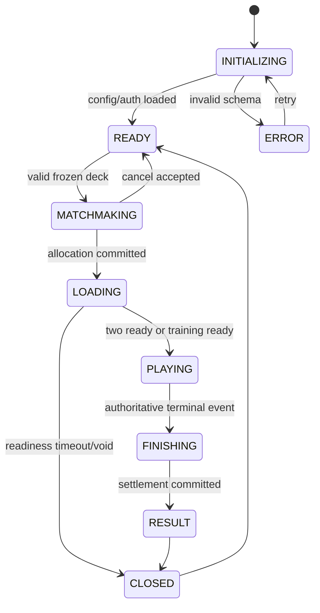
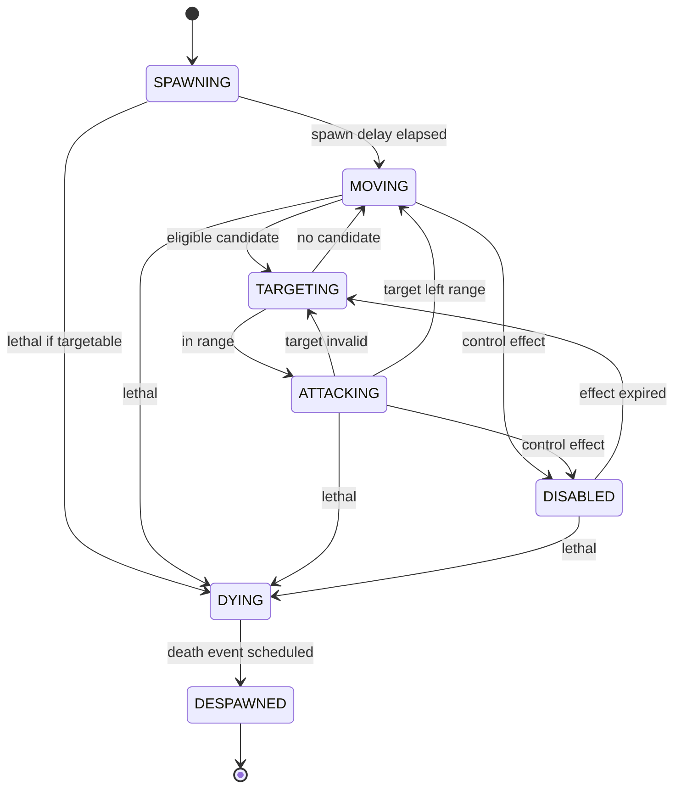

# State machines và invariants

Các state dưới đây là **Proposed**. Chúng tổ chức web implementation, không phải enum nội bộ Wildlife.

Kết nối là orthogonal state `CONNECTED ↔ RECONNECTING → EXPIRED`, không rời PLAYING khi mất socket; server tiếp tục. Settlement pending vẫn FINISHING, không phát thưởng client trước commit. Queue cancel và room allocation tranh chấp phải có một CAS winner.

Status là component đa trạng thái (`slow`, `shield`, `freeze`, `buff`), không nhân tất cả tổ hợp thành enum. Resurrection tạo entity generation mới và giữ source link; không tái sử dụng stale target reference. `DYING` logic xảy ra ngay sau lethal resolution, visual corpse có thể tồn tại lâu hơn nhưng không còn targetable.

Invariant: monotonic tick/eventSeq, unitId+generation không trùng, HP clamp [0,max], mana không âm, entity đã chết không tạo đòn mới, terminal result duy nhất, command cũ không mutate trạng thái. Attack event đã được commit trước chết có tiếp tục không là policy Proposed cần U05.
