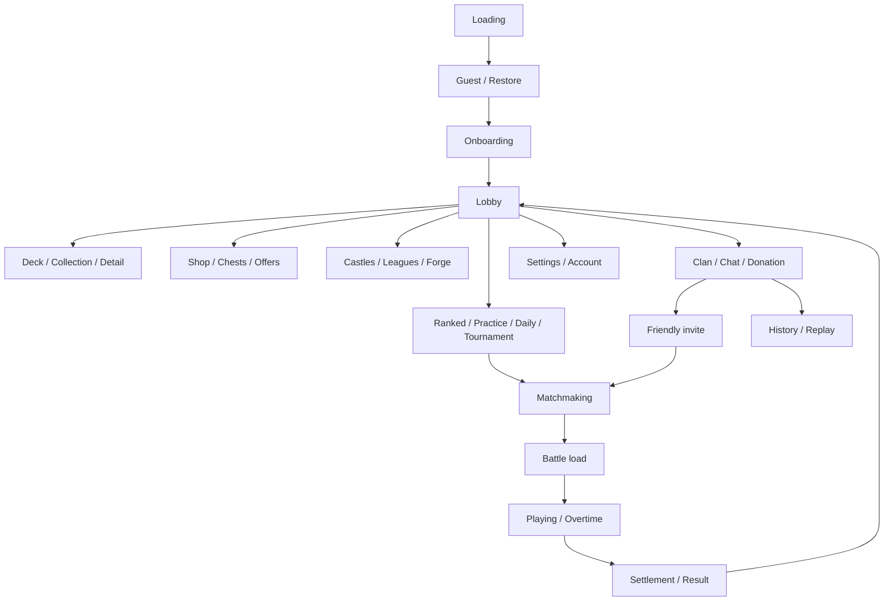
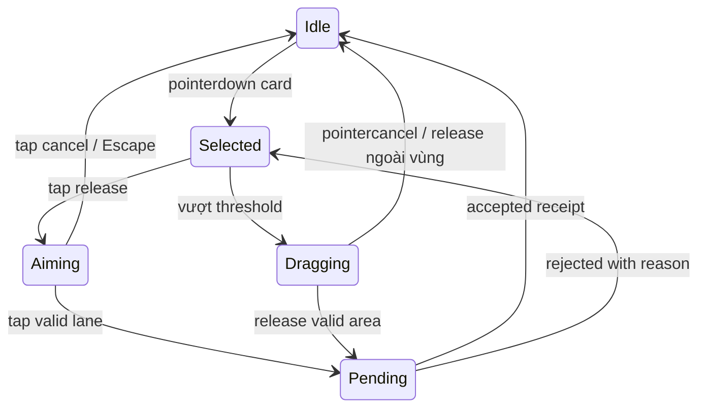

# UI/UX Specification — web Proposed

## Sitemap và flow

## States, API và lỗi

| ID | Screen | States | API đề xuất | Lỗi/khôi phục |
|---|---|---|---|---|
| S01 | Splash/Loading | loading/error/ready | `Bootstrap + manifest` | Giữ trạng thái đã xác nhận; lỗi typed; retry idempotent; refresh khi revision conflict |
| S02 | Onboarding/Guest | new/resume/recover | `POST sessions/guest` | Giữ trạng thái đã xác nhận; lỗi typed; retry idempotent; refresh khi revision conflict |
| S03 | Login/Restore | linking/conflict/error | `POST sessions/link` | Giữ trạng thái đã xác nhận; lỗi typed; retry idempotent; refresh khi revision conflict |
| S04 | Main Lobby | ready/offline/reward available | `GET me, content` | Giữ trạng thái đã xác nhận; lỗi typed; retry idempotent; refresh khi revision conflict |
| S05 | Deck Builder | valid/invalid/saving/conflict | `PUT decks/id` | Giữ trạng thái đã xác nhận; lỗi typed; retry idempotent; refresh khi revision conflict |
| S06 | Collection | loading/empty/error | `GET collection` | Giữ trạng thái đã xác nhận; lỗi typed; retry idempotent; refresh khi revision conflict |
| S07 | Card Detail | eligible/insufficient/pending | `POST cards/id/upgrade` | Giữ trạng thái đã xác nhận; lỗi typed; retry idempotent; refresh khi revision conflict |
| S08 | Battle Lobby | valid/blocked | `POST queue` | Giữ trạng thái đã xác nhận; lỗi typed; retry idempotent; refresh khi revision conflict |
| S09 | Matchmaking | searching/allocated/canceling | `POST/DELETE queue` | Giữ trạng thái đã xác nhận; lỗi typed; retry idempotent; refresh khi revision conflict |
| S10 | Battle | playing/overtime/reconnecting | `SignalR commands/snapshots` | Giữ trạng thái đã xác nhận; lỗi typed; retry idempotent; refresh khi revision conflict |
| S11 | Result | settling/committed/retry | `GET matches/id/result` | Giữ trạng thái đã xác nhận; lỗi typed; retry idempotent; refresh khi revision conflict |
| S12 | Shop | loading/expired/insufficient/pending | `GET offers; POST purchases` | Giữ trạng thái đã xác nhận; lỗi typed; retry idempotent; refresh khi revision conflict |
| S13 | Chest Opening | locked/unlocking/claimable/claimed | `POST chest unlock/claim` | Giữ trạng thái đã xác nhận; lỗi typed; retry idempotent; refresh khi revision conflict |
| S14 | Progression/League | locked/unlocked/season settlement | `GET progression` | Giữ trạng thái đã xác nhận; lỗi typed; retry idempotent; refresh khi revision conflict |
| S15 | Forge | locked/eligible/pending | `POST forge` | Giữ trạng thái đã xác nhận; lỗi typed; retry idempotent; refresh khi revision conflict |
| S16 | Rankings | loading/stale/empty | `GET leaderboard` | Giữ trạng thái đã xác nhận; lỗi typed; retry idempotent; refresh khi revision conflict |
| S17 | Profile | self/other/error | `GET players/id` | Giữ trạng thái đã xác nhận; lỗi typed; retry idempotent; refresh khi revision conflict |
| S18 | Settings | dirty/saved/offline | `Local settings; auth API` | Giữ trạng thái đã xác nhận; lỗi typed; retry idempotent; refresh khi revision conflict |
| S19 | Clan/Chat | notMember/member/requested | `Clan REST + chat hub` | Giữ trạng thái đã xác nhận; lỗi typed; retry idempotent; refresh khi revision conflict |
| S20 | Friendly Invite | active/accepted/expired | `POST invites; accept` | Giữ trạng thái đã xác nhận; lỗi typed; retry idempotent; refresh khi revision conflict |
| S21 | Daily Modes | locked/available/claimed/missed | `GET mode; POST queue` | Giữ trạng thái đã xác nhận; lỗi typed; retry idempotent; refresh khi revision conflict |
| S22 | Championship | open/playing/lost/expired/complete | `Tournament REST + battle` | Giữ trạng thái đã xác nhận; lỗi typed; retry idempotent; refresh khi revision conflict |
| S23 | History/Replay | loading/unsupportedVersion/playing | `GET replay manifest` | Giữ trạng thái đã xác nhận; lỗi typed; retry idempotent; refresh khi revision conflict |
| S24 | Piggy/Capsule | empty/filling/full/expired | `Economy REST` | Giữ trạng thái đã xác nhận; lỗi typed; retry idempotent; refresh khi revision conflict |
| S25 | Ascension/Marketplace | unknown/unavailable/linked | `Adapter pending` | Giữ trạng thái đã xác nhận; lỗi typed; retry idempotent; refresh khi revision conflict |

Quy tắc lỗi riêng: Login link conflict không overwrite progress; queue cancel race hiển thị allocated; upgrade/buy timeout đọc receipt thay vì submit key mới; battle reject trả ghost về tay; chest đã claim hiển thị receipt cũ; replay không còn engine version báo unavailable; reconnect ưu tiên snapshot và không phát âm/VFX cũ lần hai.

## Input mobile

Proposed: nút ít nhất44 CSS px, safe-area insets, không bắt buộc fullscreen/orientation lock. Landscape là bố cục ưu tiên; portrait fit battlefield có tap-to-place và card detail mở riêng. Pointer capture khi drag, `touch-action:none` chỉ trong battle interaction; cho page/menu cuộn bình thường. Một pointer điều khiển deploy, pointer thứ hai không nhân command. Ghost offset trên ngón tay; vùng valid phản hồi bằng màu+shape+text. Không đủ mana vẫn xem card, không gửi play invalid. Hủy không tiêu tài nguyên; discard nếu xác minh phải là vùng/nút khác rõ ràng, tránh hủy nhầm thành mất thẻ.

Timing Proposed: UI transition120–200ms, result reveal có skip, reduced-motion bỏ shake/zoom; không delay input để đợi tween. Damage event và animation attack lấy tick server, hit flash không quyết định HP. Audio unlock bằng user gesture, mute lưu local, tab background dừng render không pause PvP.

Loading có phase và retry asset; không bịa % dựa timer. Battle canvas có DOM HUD đọc được, keyboard select1–6 + lane keys + Escape, contrast team không chỉ đỏ/xanh. Settings chứa quality Auto/Low/High, volume, reconnect status. Acceptance trên Safari iOS thật: notch, browser chrome resize, lost pointer, app-switch30s, portrait/landscape và virtual keyboard.

## Social, invite và clan transitions

Support mở clan ở player level3, tạo clan tốn1000gold; open/invite-only/closed, clan chat, roles, donation, friendly và share replay được mô tả. [Clan](https://wildlifestudios8986.zendesk.com/hc/en-gb/articles/12684817694481-How-to-join-create-a-clan). Số50 members chỉ từ whitepaper tr.10, cần U08 xác minh. Donations đổi copies lấy gold theo support; XP được whitepaper nhắc, quota/mức thưởng chưa đủ. [Donation](https://wildlifestudios8986.zendesk.com/hc/en-gb/articles/12684689322385-Card-donations), [Castle Crush Whitepaper v2.1](https://castle-crush-crypto-bucket.s3.amazonaws.com/whitepaper/Castle%20Crush%20Whitepaper%20v2.1.pdf).

Proposed clan state: NO_CLAN→SEARCH→(REQUEST_PENDING hoặc MEMBER); leader có quyền quản trị theo role matrix cần capture, không tự gán elder/co-leader nếu không có evidence. Invite-only accept có server permission; closed không nhận join tự do. Chat pending/sent/failed có idempotent messageId. Donation show owned/remaining limit/expired; khi donor thiếu copies refresh collection và không debit. Friendly pending chặn queue; người khác accept thắng CAS chuyển hai client sang battle; cancel popup gửi cancel, race đã accepted phải vào room hoặc theo disconnect policy. Không có friend list standalone được xác minh.

Delete account UI là màn Settings con: re-auth→warning→15s confirmation→pending→start; interrupted countdown không delete. Mọi button destructive phải dùng endpoint server và confirmation rõ. Chi tiết bố trí pixel/animation của bản gốc còn U10, không lấy Proposed flow làm ảnh chụp quan sát.
