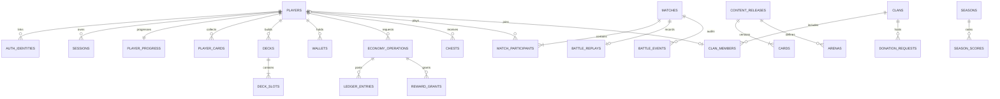

# Database Design — Proposed

Đây là logical schema để triển khai migrations ở milestone D/E/F, chưa phải cơ sở dữ liệu đã chạy. Dùng UUID cho identity, UTC `timestamptz`, `bigint` cho currency/counters và optimistic revision. Mọi enum/config được version hóa. Bảng liên quan cơ chế lịch sử chỉ bật sau gate live; không tạo bảng quest, friend graph hay battle pass khi chưa xác minh sự tồn tại.

| Table | Key | Các cột chính | Constraint/index/invariant |
|---|---|---|---|
| players | id uuid PK | display_name text, locale text, created_at timestamptz, status text | Tên bản phát hành riêng; unique ID, không bắt unique display name nếu chưa cần |
| auth_identities | id uuid PK | player_id FK players, provider text, subject text | UNIQUE(provider,subject); không gộp account theo email không verified |
| sessions | id uuid PK | player_id FK, refresh_hash bytea, expires_at, revoked_at | Hash refresh token; index player_id/expires_at; không lưu token plaintext |
| player_progress | player_id PK/FK | xp bigint, level int, trophies int, arena_id FK, deck_capacity int, revision bigint | CHECK xp>=0, level>=1; deck_capacity IN(7,14); trophy floor theo config |
| content_releases | id text PK | manifest_hash text UNIQUE, ruleset_hash text, status text, published_at | Immutable published; unknown rules không activate parity profile |
| cards | (release_id,card_id) PK | release_id FK, public_name text, rarity text, kind text, definition jsonb | JSON schema validated; card stats lookup và provenance trong content bundle |
| arenas | (release_id,arena_id) PK | trophy_threshold int, unlocks jsonb | Không ghi threshold tưởng tượng; release có đủ lookup mới active |
| player_cards | (player_id,card_id) PK | copies bigint, base_level int, revision bigint | copies>=0, level>=1; ownership stable cardId, effective stats theo release |
| decks | id uuid PK | player_id FK, slot smallint, revision bigint, selected bool | slot0..4; UNIQUE(player_id,slot); partial unique selected=true mỗi player |
| deck_slots | (deck_id,ordinal) PK | deck_id FK, ordinal smallint, card_id text | ordinal0..13; duplicate/rarity/capacity kiểm tra domain transaction |
| forge_effects | id uuid PK | player_id FK, card_id, effect_type, starts_at, expires_at, cap_unlock int | Boost có expiry; cap unlock khác base_level; effect conflict theo verified config |
| wallets | (player_id,currency) PK | balance bigint, revision bigint | balance>=0; integer minor units; gold/gems/forge crystals tách currency |
| economy_operations | id uuid PK | player_id FK, idempotency_key text, request_hash text, receipt jsonb, created_at | UNIQUE(player_id,idempotency_key); same key khác payload => conflict |
| ledger_entries | id uuid PK | operation_id FK, player_id, currency, delta bigint, reason, source_ref, created_at | Append-only; FK(player_id,currency) wallets; delta<>0; reversal tham chiếu bút toán gốc |
| reward_grants | id uuid PK | player_id FK, source_type, source_id, operation_id FK, rewards jsonb | UNIQUE(player_id,source_type,source_id); trận/chest chỉ được grant một lần |
| chests | id uuid PK | player_id FK, type_id, slot, state, granted_at, unlock_at, loot_revision, receipt_id FK | Partial unique(player_id,slot) khi occupying; partial unique(player_id) khi unlocking |
| offers | id uuid PK | content_release FK, price jsonb, grant jsonb, begins_at, ends_at, eligibility jsonb | Server price; immutable revision; daily reshuffle lưu offer assignment seed/IDs riêng |
| purchases | id uuid PK | player_id FK, provider, external_id, offer_id FK, state, receipt_hash, operation_id FK | UNIQUE(provider,external_id); signed webhook, không tin browser success page |
| entitlements | id uuid PK | player_id FK, product_id, starts_at, expires_at, source_purchase_id FK | Subscription history; perks hiệu lực theo timestamp server |
| economy_counters | (player_id,counter_type,period_key) PK | value bigint, expires_at, config_revision | Daily coins, capsule/piggy progress; period timezone phải đo U07 |
| matches | id uuid PK | mode, ruleset_hash, content_hash, core_version, status, host_epoch bigint, started_at, ended_at, winner_slot, result_hash | winner_slot NULL khi active/void; terminal result bất biến; check modes/ranked config |
| match_participants | (match_id,slot) PK | match_id FK, slot0..1, player_id FK nullable, bot_policy_id, deck_snapshot jsonb, trophies_before, trophy_delta | Player hoặc bot, không cả hai; UNIQUE(match_id,player_id); frozen deck |
| battle_replays | match_id PK/FK | private_object_key, public_object_key nullable, sha256, format_version, bytes, expires_at | Private seed/commands trong object storage; signed access; retention Proposed30d |
| battle_events | (match_id,event_seq) PK | match_id FK, tick bigint, kind, payload jsonb | Chỉ terminal/audit/important events; không ghi mọi position mỗi tick vào SQL |
| outbox | id uuid PK | aggregate_id, kind, payload jsonb, created_at, published_at, attempts | At-least-once delivery; consumer dedup eventId; index unpublished |
| seasons | id text PK | config_revision, starts_at, ends_at, league_rules jsonb | 3 tuần documented, timezone/reset lookup chưa verified |
| season_scores | (season_id,player_id) PK | season_id FK, player_id FK, trophies, league_id, reward_receipt | Index(season_id,trophies DESC,player_id); leaderboard projection có watermark |
| clans | id uuid PK | name, join_policy, minimum_trophy, leader_id FK players, revision | Capacity/creation price config; 50 là historical WP, phải confirm live |
| clan_members | player_id PK/FK | clan_id FK, role, joined_at | Một clan/player Proposed; index clan_id; role transfer transactional |
| clan_messages | id uuid PK | clan_id FK, author_id FK, kind, body, created_at, moderation_state | Length/rate/retention server policy, không nhúng HTML |
| donation_requests | id uuid PK | clan_id FK, requester_id FK, card_id, requested, fulfilled, expires_at, revision | Giới hạn theo config; donor debit/recipient copies/reward một transaction |
| donation_actions | id uuid PK | request_id FK, donor_id FK, amount, operation_id FK | Unique request+command; audit copies/gold/XP |
| friendly_invites | id uuid PK | clan_id FK, creator_id FK, acceptor_id FK nullable, status, match_id FK nullable, expires_at | CAS pending→accepted; tối đa một acceptor, creator không ranked queue đồng thời |
| mode_rotations | id uuid PK | mode_id, config_revision, starts_at, ends_at | Chỉ publish mode đã kiểm chứng; không mặc định daily schedule bản cũ |
| tournament_entries | id uuid PK | rotation_id FK, player_id FK, wins, losses, state, operation_id FK | Fees/reward/entry cap còn U08; deploy khi có ruleset đầy đủ |

`player_progress.arena_id` cần composite FK với `content_release_id` tương ứng bảng arenas. Các FK viết tắt `player_id FK` đều trỏ players.id. `card_id` ownership là identity ổn định: khi viết migrations thêm `card_keys(id)` và cards tham chiếu card_keys để bảo đảm FK qua nhiều revision; không FK ownership vào duy nhất latest release. Roster/tier variants cần thiết kế sau U04/U09, không lưu NFT entitlement trong base copy count.

## Ranh giới lưu trữ

| Store | Dữ liệu | Mất dữ liệu / recovery |
|---|---|---|
| PostgreSQL | Accounts, collection, ledger, deck, results, clan, seasonal projections | Backup/PITR; nguồn đúng của progression |
| Match actor RAM | Units, projectiles, timers, private hands/RNG, dedup commands | Crash trước durable checkpoint => void, không dựng winner từ client |
| Redis (khi cần scale) | Queue ticket TTL, presence, room routing/lease | Rebuild; không giữ số dư/rewards duy nhất tại đây |
| Object storage | Versioned art/content, private replay/checkpoints | Hash, immutable keys, lifecycle, access policy |
| Client IndexedDB | Asset cache, UI preferences, local practice replay | Có thể xóa; không authoritative wallet/deck ownership |

## Atomicity và concurrency

Ví dụ upgrade: mở transaction → reserve economy operation bằng unique idempotency key → lock player_cards và wallet theo thứ tự key cố định → validate content revision/copies/gold/level cap → update copies+gold+level+XP → append ledger/receipt/outbox → commit. Cùng key+same request trả receipt cũ; key khác payload trả409. Không có đoạn debit ngoài transaction rồi mới grant.

Result settlement: room đóng terminal một lần → server ký/internal authenticated result kèm host_epoch → transaction validate room fencing+terminal result hash → ghi participants deltas → unique reward_grants theo matchId/playerId → update trophy, chest/counter/wallet → outbox → commit. Retry sau timeout đọc receipt. Worker cũ sau failover không được ghi kết quả khác bằng cùng matchId.

Donation khóa request, donor collection, recipient collection, wallets theo thứ tự ổn định. Request fulfilled không vượt requested; mất mạng trước response không tạo donation thứ hai. Season job dùng cursor/batch+unique season award; leaderboard eventual, wallet transactional.

Read Committed + explicit row locks đủ cho nhiều thao tác; dùng Serializable cho predicate invariants khó khóa, retry toàn transaction có giới hạn và jitter khi serialization failure. Không coi kiểm tra số dư trong application trước update là đủ. [PostgreSQL isolation](https://www.postgresql.org/docs/current/transaction-iso.html).

Các giới hạn timed chest chỉ áp đúng chest class, không để Free Chest chiếm battle slot. Check ownership+row revision ở mọi mutation. Migration test: từ empty DB và snapshot version trước, concurrency50 requests một chest/upgrade, reversal, restore backup. Đây là test plan chưa chạy.
