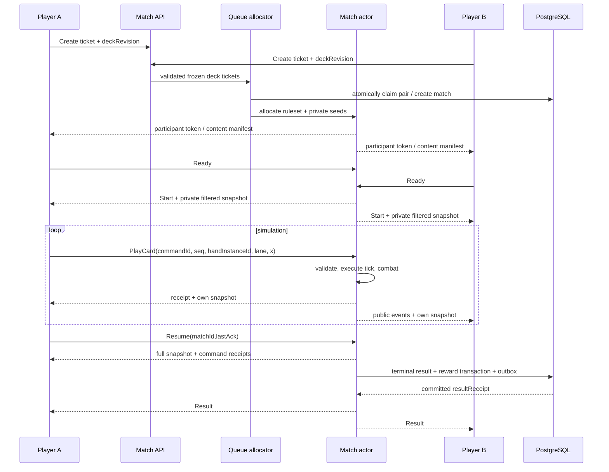

# Server-authoritative Networking

Tất cả thông số dưới đây Proposed. Match tick20Hz, broadcast10Hz, render60/30Hz. Input command không chứa HP, damage, mana hoặc winner. Gateway xác thực participant và fencing epoch; actor validate toàn bộ ở execution tick.

## Ordering, prediction, reconciliation

Server receipt sequence đóng dấu sau auth, chấp nhận một commandId một lần. Command requestedTick chỉ diagnostic; không để client backdate damage. Không lag compensation kiểu rewind shooter vì deploy-time strategy; cho UI ghost tức thời, authoritative spawn chờ ack. Reject vì thiếu mana thì rollback ghost, không HP prediction.

Snapshots public: entities, HP, effects, castle, tick, eventSeq; own-private: own hand/current mana/receipts. Không gửi opponent hand/deck shuffle/seed. Public mana nếu chưa xác minh original có hiển thị thì chỉ internal server; UI web có thể giữ private. Delta kèm baselineId; thiếu baseline phải full resync. Full snapshot định kỳ2s hoặc reconnect Proposed. Interpolation100–150ms adaptive; extrapolate tối đa100ms cho movement, không predicted damage.

Transport WebSocket ordered/reliable vẫn có head-of-line blocking. Bounded send queue, coalesce snapshot cũ; không drop reliable receipts/result. MessagePack có lợi payload phải đo; JSON dễ debug. [SignalR configuration](https://learn.microsoft.com/en-us/aspnet/core/signalr/configuration?view=aspnetcore-10.0) hỗ trợ cả hai nhưng stateful reconnect không thay được application match recovery.

## Reconnect và anti-cheat

Heartbeat5s, dead transport15s, gameplay grace30s là config Proposed tách khỏi default SignalR. Token refresh/reconnect rebind player; chỉ một active controlling socket mỗi account. Client seq/session epoch ngăn lệnh cũ của socket bị thay. Reconnect snapshot áp trước events mới; dedup effect theo eventId.

Giới hạn đề xuất ingress commands10/s burst20, payload2KiB/play, bounds kiểm tra trước deserialize deep objects. Rule-based exploit tests: stale hand, forged owner, NaN/infinity/x ngoài lane, replay command, spam paid draw, unknown ability, mismatched content hash. Không tin client checksum làm proof fairness; server hash dùng replay/internal diagnostics.

Server crash: PhaseD void active match nếu chưa terminal durable, không đổi trophy, không cấp win chest; CSPRNG seed không thể reconstruct? báo VOID. Production cần checkpoint/log durable nếu muốn recover; không hứa seamless recovery khi chỉ in-memory. Sau terminal commit mất result packet: GET result trả cùng receipt.
