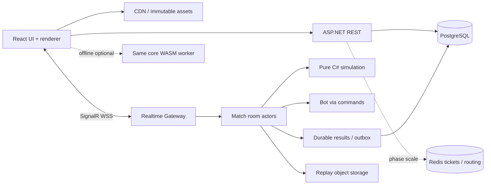

# System Architecture

Modular monolith + authoritative match rooms cho giai đoạn đầu. Không cần microservices theo từng tính năng. Có16 module: Identity, PlayerProgress, ContentCatalog, Collection, Decks, Matchmaking, BattleSimulation, RealtimeGateway, AI, ResultsRewards, WalletShopChests, ForgeSeasons, ClansChatDonations, ModesTournaments, ReplayTelemetry, WebPresentation. Ascension adapter nằm trong Content/Wallet với gate riêng, không triển khai chain chỉ vì tài liệu lịch sử.

Server owns all battle truth; client owns presentation. Content hash gắn assets, ruleset, protocol, replay binary. Không đưa model transforms vào database combat. Match actor single writer nhận commands từ bounded mailbox; gateway chỉ authenticate/route/serialize, không giữ business state trong Hub instance.

API process và match process có thể cùng deployment ban đầu nhưng module riêng để sau tách worker. Một match được một worker sở hữu bằng lease+fencing epoch. Result có unique matchId; duplicate worker không settle được hai lần. Redis mất không làm wallet mất; worker vẫn chạy trận hiện có.

Boundary source: mô hình này do thiết kế đề xuất; không có bằng chứng Wildlife dùng stack/tick-rate/DB này.
