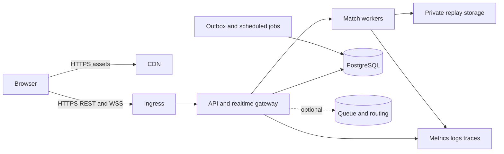

# Deployment Plan — chưa triển khai dịch vụ

Development chạy Windows/Laragon được nhưng sản phẩm không phụ thuộcPHP/Apache. Sau gate A, dùng frontend devserver, backend ASP.NET, PostgreSQL container; game files đặt theo architecture. Không cài hoặc mở port production ở lượt tài liệu này.

## Environments và release pipeline

Local→CI ephemeral→staging→production. Separate DB/buckets/payment/provider credentials theoenv; không lấy prodplayers để testreward. Lock dependency versions, SBOM và assetlicense manifest. Build frontend/content immutablehash; build core/server container bằng pinned SDK/baseimage; không deploy `latest`. CI: validate content/docs→type/lint/build→unit/replay→integrationmigration→browser smoke→package+vulnerabilityreview. Performance trên dedicateddevices ngoài ephemeralCI đểgiảmnoise.

Staging: deployschemaexpand tương thíchngược, seed labaccounts khôngfakeoriginaldata, runfullmatch+wallet/drain/recoverycanary. Production: backup/checkrestoreage→applyexpandmigration→deploynewworkers→route newmatches to compatiblecore→drainoldrooms→watcherrors/latency/settlement→switchfrontendmanifest→latercontractmigration. Không kill room đang đấu chỉ vì deploy. Rooms pin core/content; artifacts cũ cần giữ cho live/replay. Canary là traffic/appchoice được duyệt khi tới release, chưa gửitrafficbâygiờ.

Singlehost ban đầu: ingress + API/match workers + jobs containers, managed hoặc separatePostgreSQL; backupraoff-host. Redis optional chỉ khi nhiềuworkers cần sharedqueue/routing. Sticky routing hoặc matchrouter đảm bảo connection vào ownerroom; SignalRbackplane không tự di chuyển actorstate. Linux container resource limits/health checks; readinessfalse khi CPU/backlogquácapacity, liveness chỉ phát hiện processkẹt, tránh restartloop khiDBchậm.

## Configuration/secrets

Public: APIbaseURL,protocolVersion,contenthash,buildID. Secrets: DBconnection,session signingkeys,OIDC/clientsecrets,webhookverifykeys,objectstoragecredentials,internalroomservicekeys. Secretstore/host-mounted secretfiles, leastprivilege vàrotation; không VITE_* secret, khônglogtokens. TLS/cookieSecure/HttpOnly/SameSite, CORS allowlist, CSRF cho cookie-auth mutations, authorizedwebsocketorigins. CDN immutable assets longcache; manifest shortTTL/ETag. ServiceWorker/PWA thêm sau để tránh staleprotocol với live room.

## Observability và response

Metrics: active/queuedmatches,queuewaitp95,roomtickp95/p99,backlog,entities,serializationbytes,snapshotgap,resyncrate,commandrejectbyreason,reconnectsuccess,resultpendingage,outboxlag,ledgerreconcileerrors,DBlatency/pool,OOM/clientcrash. Logs: correlation matchId/commandId/receiptId,versions,hostepoch; không privatehand/seed hayPII mặcđịnh. Usererrorreport có consent và bounded attachment; source maps private.

Alert thresholds Proposed: tickp99>100ms5phút; resultpending>30s; any ledgerimbalance/duplicatedbusinessgrant; error5xx>1%5phút; DBstorage>80%; backupfailed; crashrate doubled versusacceptedbaseline. Severity/quietwindow/on-callroute xác địnhtrước publiclaunch. Runbooks: disable newqueue,drain,voidunrecoverablerooms,retrysafeoutbox,pausepurchases,restorepaymentreceipts. Không manualupdate balance thiếuledger.

## Backup, retention, rollback

Planning targets progressionledger RPO≤5phút/RTO≤60phút cần PITR/WAL/offsitebackup vàrestoretestthực; nightlydumpmộtmình không đạtRPO5phút. Replaycache có thểRPO24h; in-progressmatchcrashvoid làdeviationđãcôngbố nếu checkpoint chưađạt. Monthlyrestore vào isolatedDB; verifycounts,hashes,FK,wallet=sumledger baseline,latestsettlement,login/replayaccess. Không giảrestorepass từ backupjob thànhcông.

Retention Proposed: private replay30ngày; detailed transportlog7ngày; aggregate metrics90ngày; economicreceipt theo yêu cầu phát hành/provider đãreview; người dùng deleteaccount cần thực hiệnanonymization/retentionđúngpolicy, khôngtựxóaauditđangcần. Quy địnhpháp lýcụthểngoàiphạmvinghiêncứucơchếnày.

Rollback frontendmanifest/serverrouting vềbuild compatible; migrationexpand giữschemascũ. Không rollback destructiveDB migration bằngdownscriptmù; restore/PITR cóincidentplan vàreconcilepayments xảyra saurestorepoint. Contentrollback ảnhhưởngmatchmới, khôngchange stats củaroomđangchạy. Releaseapproval cuối cần konkret commit/artifact/capacity/parityreport khi phầnmềmđãcó; chưa có productiondeployment hoặcclaim SLA trong hồsơ này.
