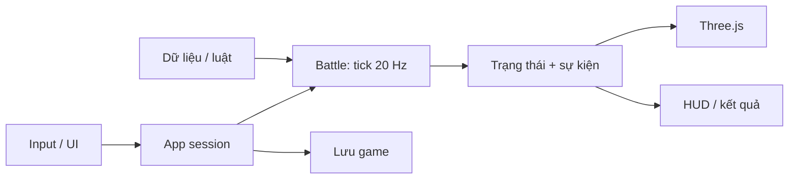

# Kiến trúc Kora War — Three.js

Bản refactor ngày 13/10/2026 tiếp tục bản chơi được tại commit `e792b00`. Không viết lại gameplay và không thay renderer. Mục tiêu là chỉnh cân bằng, thêm kỹ năng hoặc nâng đồ họa mà không phải sửa cùng một file lớn.

## Cấu trúc thực tế

```text
src/
  main.ts                     entry point của Vite
  app/
    bootstrap.ts              điều phối phiên chơi, input, HUD, debug
    fixed-step-runner.ts       đưa tick 20 Hz vào core, giới hạn catch-up
  data/
    types.ts                  schema tướng/hệ/tộc
    heroes.ts                 10 tướng và hai deck mặc định
    traits.ts                 tên và mô tả hệ/tộc
    synergies.ts              đếm hệ/tộc trong deck
    abilities.ts              điều kiện và hiệu ứng của 10 kỹ năng
    rules.ts                  HP, mana, tick, trụ, quá tải, giới hạn
    map.ts                    tọa độ ba lane
    story.ts                  cốt truyện chương đầu Aetherfall
    validate.ts               kiểm tra dữ liệu khi khởi động
  core/
    Battle.ts                 trạng thái trận và thứ tự thực thi hệ thống
    types.ts                  Unit, Tower, GameEvent, Stats, Phase
    ai/heuristic.ts           chấm điểm lane và lựa chọn thẻ
    systems/
      deployment.ts           xác thực vùng thả, thẻ, mana và spawn
      damage.ts               sát thương, lá chắn, hồi máu, hạ gục
      cast-ability.ts         thực thi cấu hình kỹ năng
      pulse.ts                Cộng Hưởng Lõi
      mana.ts                 hồi tài nguyên
      units.ts                trạng thái, mục tiêu, đánh và di chuyển
      towers.ts               trụ tự tìm và đánh mục tiêu
      victory.ts              quá tải và kết quả
  rendering/
    World.ts                  camera, render, raycast, batching, VFX
    environment.ts            địa hình, rừng, sông, cầu, trụ, căn cứ
    hero-model.ts             mô hình nhân vật thủ tục và bộ phận động
    resources.ts              cache geometry/material và vòng đời GPU
  ui/
    shell.ts                  khung giao diện
    icons.ts, dom.ts, modal.ts thành phần dùng chung
    screen-context.ts         hợp đồng giữa app và các màn hình
    screens/                  truyện, đội hình, cài đặt, pause, kết quả
  services/
    save-store.ts             đọc/kiểm tra/lưu dữ liệu localStorage
    audio.ts                  Web Audio tổng hợp
tests/                        regression, mô phỏng, dữ liệu, vòng lặp/save
tools/check-architecture.mjs   kiểm tra ranh giới dependency
```

Các file export tương thích ở gốc `src` giữ đường import cũ hoạt động; chỉ có một implementation cho mỗi chức năng.

## Luồng dữ liệu



`Battle.step()` thực thi mana → AI → unit → trụ → loại quân chết → kết quả. Thứ tự này giữ nguyên từ prototype; thay đổi thứ tự có thể thay đổi kết quả trận. PRNG có seed nằm trong Battle. `FixedStepRunner` không truyền delta thời gian biến thiên vào combat; render 30, 60 hoặc 144 Hz cho cùng trạng thái sau cùng số giây mô phỏng. Khi khung hình bị treo, catch-up tối đa 12 tick/khung để tránh vòng lặp quá tải.

Kỹ năng là dữ liệu gồm điều kiện kích hoạt, truy vấn mục tiêu và các hiệu ứng damage/heal/shield/slow/stun. Thêm tướng dùng các hiệu ứng hiện có chỉ cần cấu hình; một loại hiệu ứng mới cần bổ sung handler và test. Renderer không chứa thông số sát thương.

## Vòng đời và tài nguyên

Một phiên trang có một World. Đổi trận gọi `World.reset()`: xóa quân/VFX và con trỏ sự kiện, đặt lại batch, tái sử dụng geometry/material. Hủy ứng dụng gọi `World.dispose()`: ngắt ResizeObserver, dọn scene, GPU resource, renderer và canvas. HMR cũng hủy requestAnimationFrame, sự kiện document/canvas và AudioContext.

Các geometry/material dùng chung thuộc World, không bị hủy khi một unit chết. Cây/địa hình được gộp theo material; quân dùng InstancedMesh. Cache hiện hỗ trợ một World trong một trang; không tạo nhiều World đồng thời nếu chưa tách cache theo instance.

## Hướng nâng cấp

| Thay đổi | Nơi sửa chính | Kiểm tra |
|---|---|---|
| HP/mana/trụ/thời gian quá tải | `data/rules.ts` | regression và test luật |
| Chỉ số/tên tướng | `data/heroes.ts` | validate và test deck/combat |
| Sát thương/điều kiện kỹ năng | `data/abilities.ts` | test hiệu ứng và trận seeded |
| Mô hình/animation | `rendering/hero-model.ts` | hình ảnh, FPS, restart |
| Map và cây/cầu | `rendering/environment.ts` | camera, vùng thả, mobile |
| Cốt truyện | `data/story.ts` | màn hình mở đầu, hướng dẫn |
| Chính sách AI | `core/ai/heuristic.ts` | trận seeded, ngân sách mana |

Chưa có server/PvP, GLB rigged animation, replay command log đầy đủ hoặc Editor. `snapshot()` là ảnh chụp chẩn đoán, không phải save/restore trận đấu hoàn chỉnh. Những phần này cần triển khai riêng khi được chọn làm bước tiếp theo.
