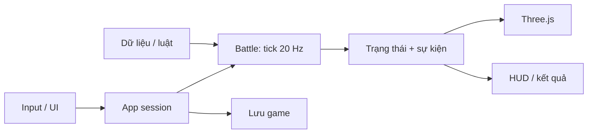

# Kiến trúc Kora War — Three.js

Bản refactor ngày 13/10/2026 tiếp tục bản chơi được tại commit `e792b00`. Không viết lại gameplay và không thay renderer. Mục tiêu là chỉnh cân bằng, thêm kỹ năng hoặc nâng đồ họa mà không phải sửa cùng một file lớn.

## Cấu trúc thực tế

```text
src/
  main.ts                     entry point của Vite
  app/
    bootstrap.ts              điều phối phiên chơi, input, HUD, debug
    fixed-step-runner.ts       đưa tick 20 Hz vào core, giới hạn catch-up
  data/
    types.ts                  schema tướng/hệ/tộc
    heroes.ts                 10 tướng và hai deck mặc định
    traits.ts                 tên và mô tả hệ/tộc
    synergies.ts              đếm hệ/tộc trong deck
    abilities.ts              điều kiện và hiệu ứng của 10 kỹ năng
    rules.ts                  HP, mana, tick, trụ, quá tải, giới hạn
    map.ts                    tọa độ ba lane
    story.ts                  cốt truyện chương đầu Aetherfall
    validate.ts               kiểm tra dữ liệu khi khởi động
  core/
    Battle.ts                 trạng thái trận và thứ tự thực thi hệ thống
    types.ts                  Unit, Tower, GameEvent, Stats, Phase
    ai/heuristic.ts           chấm điểm lane và lựa chọn thẻ
    systems/
      deployment.ts           xác thực vùng thả, thẻ, mana và spawn
      damage.ts               sát thương, lá chắn, hồi máu, hạ gục
      cast-ability.ts         thực thi cấu hình kỹ năng
      pulse.ts                Cộng Hưởng Lõi
      mana.ts                 hồi tài nguyên
      units.ts                trạng thái, mục tiêu, đánh và di chuyển
      towers.ts               trụ tự tìm và đánh mục tiêu
      victory.ts              quá tải và kết quả
  rendering/
    World.ts                  camera, render, raycast, batching, VFX
    environment.ts            địa hình, rừng, sông, cầu, trụ, căn cứ
    hero-model.ts             mô hình nhân vật thủ tục và bộ phận động
    resources.ts              cache geometry/material và vòng đời GPU
  ui/
    shell.ts                  khung giao diện
    icons.ts, dom.ts, modal.ts thành phần dùng chung
    screen-context.ts         hợp đồng giữa app và các màn hình
    screens/                  truyện, đội hình, cài đặt, pause, kết quả
  services/
    save-store.ts             đọc/kiểm tra/lưu dữ liệu localStorage
    audio.ts                  Web Audio tổng hợp
tests/                        regression, mô phỏng, dữ liệu, vòng lặp/save
tools/check-architecture.mjs   kiểm tra ranh giới dependency
```

Các file export tương thích ở gốc `src` giữ đường import cũ hoạt động; chỉ có một implementation cho mỗi chức năng.

## Luồng dữ liệu

App hiện hành tạo `cycleBattle()` (`cycle-v1`): `DrawDeck` quản lý hand/pile/discard bằng PRNG của Battle, đọc luật từ `content.gameplay` (mặc định 14/6). `play`/`cast` xác thực UID, mana/cooldown/vị trí rồi mới tiêu thẻ và rút vào cùng ô. Mulligan chỉ ở phase ready; cả hai phía chốt mới chạy tick. `tacticalBattle()` và constructor legacy giữ đường replay/fixture cũ.

PvP chỉ trả tay của người xem, số thẻ đối thủ và thông tin chồng rút của mình; seed/pile/discard không truyền ra client. Client dùng `hands` nhận từ snapshot để kiểm tra chọn thẻ, không dùng DrawDeck dự phòng của renderer để quyết định lượt rút. Server sở hữu combat và rút bài. Replay luyện tập lưu `cycle-v1`, deck 14, chốt bài tick 0 và UID lệnh play/spell; save local có trường `cards`, vẫn đọc được key/schema cũ.



`Battle.step()` thực thi mana → AI → unit → phép (tactical/cycle) → trụ → loại quân chết → kết quả. Đường legacy giữ thứ tự prototype; thay đổi thứ tự có thể thay đổi kết quả trận. PRNG có seed nằm trong Battle. `FixedStepRunner` không truyền delta thời gian biến thiên vào combat; render 30, 60 hoặc 144 Hz cho cùng trạng thái sau cùng số giây mô phỏng. Khi khung hình bị treo, catch-up tối đa 12 tick/khung để tránh vòng lặp quá tải.

Kỹ năng là dữ liệu gồm điều kiện kích hoạt, truy vấn mục tiêu và các hiệu ứng damage/heal/shield/slow/stun. Thêm tướng dùng các hiệu ứng hiện có chỉ cần cấu hình; một loại hiệu ứng mới cần bổ sung handler và test. Renderer không chứa thông số sát thương.

## Vòng đời và tài nguyên

Một phiên trang có một World. Đổi trận gọi `World.reset()`: xóa quân/VFX và con trỏ sự kiện, đặt lại batch, tái sử dụng geometry/material. Hủy ứng dụng gọi `World.dispose()`: ngắt ResizeObserver, dọn scene, GPU resource, renderer và canvas. HMR cũng hủy requestAnimationFrame, sự kiện document/canvas và AudioContext.

Các geometry/material dùng chung thuộc World, không bị hủy khi một unit chết. Cây/địa hình được gộp theo material; quân dùng InstancedMesh. Cache hiện hỗ trợ một World trong một trang; không tạo nhiều World đồng thời nếu chưa tách cache theo instance.

## Hướng nâng cấp

| Thay đổi | Nơi sửa chính | Kiểm tra |
|---|---|---|
| HP/mana/trụ/thời gian quá tải | Admin Gameplay → database rules/gameplay | regression và test luật |
| Chỉ số/tên tướng | Admin Nhân vật → database heroes | validate và test deck/combat |
| Sát thương/điều kiện kỹ năng | Admin Nhân vật → database abilities | test hiệu ứng và trận seeded |
| Mô hình/animation | `rendering/hero-model.ts` | hình ảnh, FPS, restart |
| Map và cây/cầu | `rendering/environment.ts` | camera, vùng thả, mobile |
| Cốt truyện | `data/story.ts` | màn hình mở đầu, hướng dẫn |
| Deck, phép, synergy, AI | Admin Gameplay → database gameplay | trận seeded, ngân sách mana |

Đã có Content Studio, GLB rigged animation và backend xác minh thưởng từ command log. Đã bổ sung PvP phòng riêng trên Node với reconnect cùng cookie; chưa persist trận qua server restart. `snapshot()` là ảnh chụp chẩn đoán, không phải save/restore trận đấu hoàn chỉnh. Những phần này cần triển khai riêng khi được chọn làm bước tiếp theo.

## Content Studio / data service

`server/database.ts` quản lý SQLite và transaction; `server/assets.ts` kiểm tra/nhập file; `server/game-service.ts` thực thi ví, cửa hàng, nâng cấp và replay thưởng; `server/http.ts` chịu trách nhiệm HTTP/auth/origin. `src/data/content.ts` là schema dùng chung, không import server/DOM. `src/services/game-session.ts` nối app với API; mỗi Battle nhận bản sao content và levels tại lúc bắt đầu. Core không tự fetch hoặc đọc database.

`server/rule-module-store.ts` quản lý 15 module rule với schema/data version riêng và history theo revision. `src/data/rule-modules.ts` extract/compose/migrate dữ liệu; `data/gameplay/` tách types/defaults/validation/deck/synergy. `core/modules/pipeline.ts` điều phối các system theo thứ tự xác định, Battle giữ state/command façade. Xem [module rule và cách nâng cấp](RULE-MODULES.md).

`src/admin` tách controller, views, ability editor, HTML helpers và preview 3D. `src/rendering/assets/model-library.ts` cache GLTF, clone skeleton và tạo AnimationMixer theo instance. `tools/compact-glb.ts` đóng gói model cho mobile; manifest/provenance ở `assets/riot/`. Xem [vận hành admin](ADMIN.md).

`src/data/media.ts` định nghĩa mixer/cue/texture binding. `Sound` đọc sự kiện và trạng thái, giới hạn voice/cooldown, bộ nhớ decoded 16 MiB, tối đa bốn request đồng thời; pause/mute dừng voice. `TerrainStyle` nạp texture qua asset ID và giữ fallback. Audio và renderer không thay đổi simulation.

`backend/KoraWar.AssetApi` tách metadata PostgreSQL khỏi object storage local/R2. `server/asset-service.ts` là cầu nối nội bộ: upload local trước, ghi pending khi mất kết nối, kiểm tra SHA khi đọc từ service. Xem [lộ trình backend](BACKEND-MIGRATION.md); PostgreSQL hiện chưa là nơi ghi ví/trận chính.

## Tactical MVP và PvP

`core/cycle-battle.ts` tạo luật hiện hành từ content database, mặc định 4 mana, deck 14/tay 6 và chỉ số chuẩn hóa. `core/tactical.ts` giữ bản 4 tướng + 2 phép để replay cũ tiếp tục hoạt động. `core/systems/spells.ts` validate/cast/update vùng phép, `spell-effect.ts` diễn giải chuỗi hiệu ứng; `data/gameplay.ts` định nghĩa schema/validation/preset tương thích. `Battle()` mặc định giữ compatibility với fixture/replay legacy. Core không đọc database trực tiếp; app/server cấp content snapshot. Xem [cấu hình gameplay](GAMEPLAY-CONFIG.md).

`server/pvp.ts` sở hữu Battle và đồng hồ server, nhận command có ID, khóa loadout và xác thực thành viên theo cookie gateway. `core/online-state.ts` trả bản sao state theo góc nhìn phe; `services/pvp-session.ts` poll khoảng 10 Hz, loại packet cũ theo version, giữ mã phòng cho reconnect. App online không gọi `step()`. Renderer đọc spell zones để vẽ cảnh báo. Room không persist; SignalR/PostgreSQL match persistence vẫn là bước sau.

## Đấu trường và kết quả bền vững (15/10/2026)

`data/competition.ts` định nghĩa schema/preset, tính Elo và áp dụng biến thể Thử thách trên bản sao content. Module `competition` là module rule thứ 18. `server/competition-store.ts` lưu trận, thành viên, kết quả và rating bằng transaction; `server/pvp.ts` ghép hàng chờ theo mode/revision, tiến mô phỏng bằng heartbeat và gọi settlement idempotent. `ui/screens/pvp.ts` hiển thị chế độ, bảng hạng và lịch sử; admin có `competition-editor.ts`. Xem [quy tắc và QA](COMPETITION.md).

Kết quả PvP nay persist; state mô phỏng/phòng vẫn trong bộ nhớ một tiến trình. Restart ghi hủy trận còn active, không đổi Elo; chưa khôi phục trận đang chơi từ database. Các mô tả “chưa persistent ranked/rewards” ở tài liệu lịch sử không áp dụng cho Elo mới; chưa thêm thưởng tiền/vật phẩm PvP.

## Admin match review

`server/fair-play-store.ts` quản lý dữ liệu vận hành kiểm duyệt (policy versioned riêng, command evidence, moderation actions, bans và Elo corrections). `PvpRooms` ghi bằng chứng tại command boundary, tự giữ bài và kết thúc trận; không gửi seed/log đối thủ qua snapshot người chơi. Admin API có cùng session/origin protection với Content Studio. Xem [FAIR-PLAY.md](FAIR-PLAY.md) về giới hạn bằng chứng và tác động xử lý.
