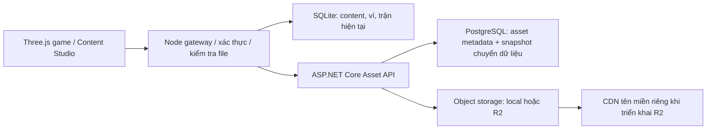

# PostgreSQL / ASP.NET Core / object storage

Ngày 13/10/2026 người dùng chọn chuyển từng bước, giữ chơi AI, hoàn thiện asset/admin/database trước PvP. PostgreSQL 17 đã có trên máy; người dùng sẽ cấu hình database riêng `kora_war` trong `.env.local`. Chưa có R2. Three.js, luật trận và lore Elyndra tiếp tục như [quyết định](DECISIONS.md).

## Bước triển khai hiện tại

`backend/KoraWar.AssetApi` dùng ASP.NET Core 10, Npgsql và AWS S3 SDK. Đây là API nội bộ cho asset, bind loopback `127.0.0.1:8790`, yêu cầu token cho tất cả endpoint. Node gateway tiếp tục đăng nhập admin, kiểm tra GLB/audio, quản lý bản nháp/published và economy. Browser chỉ gọi gateway; service token và R2 key không đưa vào bundle.

PostgreSQL lưu `kora.assets`, `kora.asset_audit`, `kora.schema_migrations`, `kora.migration_snapshots`. Asset ID bất biến, SHA-256 xác thực nội dung, JSONB lưu nguồn/giấy phép/animation/audio metadata. Local object storage có cùng giao diện với R2. File được ghi trước transaction metadata; retry không tạo ID mới hoặc thay binary đã tồn tại.

Snapshot chứa catalog, bản nháp/published, revisions, người chơi, thẻ, ví/ledger, trận và audit. Không xuất admin password hash hay session token. Snapshot là bản sao phục vụ chuyển dữ liệu; ví và trận hiện vẫn ghi vào SQLite. Chưa chuyển thành các bảng nghiệp vụ PostgreSQL hay tài khoản cross-device. Không bật hai nơi cùng ghi ví.

## Cấu hình và chạy

1. Copy `.env.example` thành `.env.local`; đặt connection string database `kora_war` và token ngẫu nhiên ít nhất 32 ký tự. Migration chỉ tạo schema `kora` trong database đã chỉ định. Nếu database riêng chưa có, sau `backend:build` chạy `dotnet backend/KoraWar.AssetApi/bin/Debug/net10.0/KoraWar.AssetApi.dll --create-database` từ thư mục gốc bằng tài khoản có quyền tạo database. Lệnh chỉ tạo `kora_war`, không xóa hay sửa database khác. `.env.local` bị loại khỏi Git. Các biến môi trường đã đặt có ưu tiên hơn file.
2. `npm run backend:build`, rồi `npm run backend:dev` trong terminal riêng. Dừng service bằng Ctrl+C.
3. `npm run assets:sync` sao chép asset và snapshot hiện tại, kiểm tra checksum từng file. Có thể chạy lại. Không tự chuyển ví/trận hay xóa SQLite. Asset upload/ẩn/khôi phục qua dashboard sau đó tự đồng bộ khi service đã cấu hình.
4. Chạy `npm run assets:verify` để đọc lại toàn thư viện và xác minh SHA-256 qua service. Sau đó có thể đổi `KORA_ASSET_READ_SOURCE=service` và khởi động lại Node để đọc binary từ service. Gateway kiểm tra checksum khi đọc, dùng local khi service chưa có file hoặc mất kết nối. Giữ bản local trong giai đoạn chuyển.
5. Dashboard cho biết service asset đang dùng PostgreSQL/local/R2. Upload được lưu local trước; nếu đồng bộ thất bại có trạng thái pending trong database và thông báo. `assets:sync` thử đồng bộ lại toàn thư viện.

`backend:dev` build rồi chạy DLL từ thư mục gốc; tránh `dotnet run` đổi working directory và đọc sai `.env.local`/object root. Nếu PostgreSQL không kết nối được, service thoát với SQLSTATE và thông báo đã lọc, không in connection string.

Ngày 13/10/2026: đã tạo database riêng `kora_war`, chạy schema migration và đồng bộ 43 asset cùng snapshot SQLite bằng cấu hình local được người dùng cung cấp, gồm sáu sheet GegX mới. Đọc lại 85,01 MiB của toàn thư viện (gồm cả bản nguồn/bản nhập trước đây) khớp SHA-256; đây không phải dung lượng tải mỗi trận. Đã bật service reads trong cấu hình local. Ví/trận vẫn ghi SQLite. Thông tin đăng nhập và service token chỉ nằm trong `.env.local`.

Service token cần truyền nội bộ qua `X-Kora-Service-Token`; không mở API này trực tiếp làm API đăng nhập public. Ngoài loopback, cần HTTPS và mạng riêng/reverse proxy. API chỉ nhận asset đã được gateway kiểm tra ngân sách mesh/audio; lớp C# kiểm tra lại checksum, magic, loại file và provenance.

## Cloudflare R2 / CDN

Khi đã có bucket, đặt provider `r2` cùng account ID, access key, secret key và bucket. Không tự tạo tài khoản/bucket, không phát sinh đăng ký dịch vụ. Adapter tương thích S3 sử dụng cấu hình payload/checksum theo [Cloudflare .NET SDK example](https://developers.cloudflare.com/r2/examples/aws/aws-sdk-net/).

CDN production dùng custom domain và CORS đúng origin game theo [R2 public bucket docs](https://developers.cloudflare.com/r2/buckets/public-buckets/). `KORA_CDN_BASE_URL` là cấu hình dành cho bước triển khai CDN tiếp theo; gateway hiện phục vụ asset qua API, chưa redirect ra CDN. Đổi provider của ID đã đồng bộ cần migration storage có kiểm tra; service từ chối tự đổi để tránh metadata chỉ tới nơi thiếu file. R2 chưa được kiểm thử trên bucket thật.

## PvP tiếp theo

API SignalR truyền command có sequence/tick và snapshot; mỗi trận do một server worker sở hữu. Không ghi vị trí quân vào PostgreSQL mỗi frame. PostgreSQL lưu tài khoản, deck, content revision, ledger và kết quả/command log; object storage giữ replay lớn nếu cần.

Trước khi chuyển luật sang C#, cần bộ fixture chung chứng minh kết quả tương đương TypeScript và xác định một implementation authoritative. Quyết định cân bằng được gắn content revision từ đầu trận, không thay giữa trận. Tiếp đó mới thêm matchmaking, reconnect, chống gửi command lặp và chịu tải. Đây là lộ trình C#/SignalR. Quyết định MVP sau đó đã bổ sung phòng PvP bằng Node/TypeScript, dùng chính core hiện có; xem [phân tích MVP](PROJECT-REVIEW.md).

## Kiểm thử

`npm run backend:check` khởi tạo PostgreSQL tạm trong `.data` và Asset API trên các port loopback trống. Password ngẫu nhiên, SCRAM; không dùng PostgreSQL production của bạn. Fixture WAV được tạo trong bộ kiểm thử, không cần tải asset trước. Script kiểm tra auth, migration, import/retry, SHA/bytes, ID bất biến, binary roundtrip, provenance và snapshot. Database/log tạm được giữ trong cache để chẩn đoán, process được dừng sau test.
