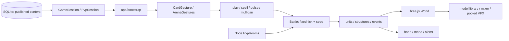

# Kora War: kiểm toán project và hướng Castle Crush

Ngày 17/10/2026. Mốc khảo sát `d995342`; issue [#90](https://github.com/huyplay/Kora-War/issues/90). Ưu tiên người dùng chọn: **model tướng, hoạt ảnh và kỹ năng**. Báo cáo này thay phần mô tả hiện trạng trong `PROJECT-REVIEW.md` ngày 13/10; các quyết định gameplay trong AGENTS.md vẫn có hiệu lực.

## 1. Kết luận thiết kế

Kora War đã là game chiến thuật thẻ có thể chơi, có mô phỏng xác định, database nội dung, PvP do server xác nhận và pipeline model. Việc cần làm tiếp là nối các phần này thành trải nghiệm dễ đọc: người chơi thấy ai đang đánh, kỹ năng nào vừa tung, ai nhận hiệu ứng và vì sao một thẻ dùng được.

Castle Crush là trục thiết kế: quyết định **thẻ nào, lane nào, lúc nào**, quân tự giao tranh và áp lực tiến về thành. TFT cung cấp tham khảo về việc nhận biết vai trò, hệ/tộc và xây đội hình. Liên Quân cung cấp tham khảo về dáng tướng, động tác và phân biệt kỹ năng. Đây là phân vai tham khảo cho Kora War, không phải tuyên bố ba game dùng chung luật hoặc engine.

Giữ thế giới Elyndra, deck 14 thẻ khác nhau, tay 6, mana 4/10 hồi 1,05/giây, ba lane, tiền tuyến, trụ/lõi, chỉ số chuẩn hóa và quá tải 180 giây. Không thêm joystick, cửa hàng tướng trong trận, ghép sao, trang bị, jungle, windup hay đổi thời điểm sát thương trong đợt này.

## 2. Nguồn và mức độ kiểm chứng

| Nguồn | Đã dùng để xác minh | Giới hạn |
|---|---|---|
| Mã Kora War tại `d995342` | 178 file trong `src`, 19 file server, 12 file backend C#; lần theo các luồng chính và xem các phân hệ bên dưới | Khảo sát kiến trúc và các đường chạy chính; không phải chứng minh từng dòng không có lỗi |
| [REA](https://github.com/morluto/rea), repo tham chiếu `e5ee3ac658cd10ba23700e1757c86ce0a4520406`; CLI `rea-agents@6.5.0` | Phân tích tĩnh riêng `src` và `server`, lưu Evidence và bản tóm tắt | Không cài MCP/global, không thực thi code của mục tiêu; phân tích tĩnh không chứng minh hành vi runtime |
| [Castle Crush trên Google Play, nhà phát hành Wildlife Studios](https://play.google.com/store/apps/details?id=com.tfgco.games.strategy.free.castlecrush&hl=en-US) | Game đối kháng chiến thuật bằng quân/phép, thu thập/nâng cấp, mục tiêu phá thành | Không đủ bằng chứng về công thức mana, thuật toán targeting hay thời điểm hit của phiên bản hiện hành |
| [Trang TFT của Riot](https://teamfighttactics.leagueoflegends.com/en-us/) | Auto-battler theo vòng, draft và triển khai đội hình, thích ứng chiến thuật | Chỉ dùng mô tả chính thức ở mức thể loại; không nhập luật mùa hiện tại vào Kora |
| [Học viện Liên Quân của Garena](https://lienquan.garena.vn/hoc-vien/che-do-choi/), [Tướng/Skin](https://lienquan.garena.vn/hoc-vien/tuong-skin/) | Hệ sinh thái tướng và các mode, gồm 5v5 | Không phân tích APK, shader hoặc animation graph của Liên Quân |
| Published content revision 29, chỉ đọc | Catalog 14 tướng, 73 asset; kiểm tra GLB cục bộ và tên clip | Dữ liệu cục bộ có thể khác một môi trường triển khai khác |
| Test và browser QA | Baseline 434 test; kết quả sau thay đổi xem `HERO-ANIMATION-QA.md` | Browser desktop giả lập kích thước mobile; chưa là QA điện thoại vật lý |

Lệnh REA đã chạy:

```powershell
npx --yes rea-agents@6.5.0 analyze-javascript-application D:/APP/laragon/www/castle-crush/src --json
npx --yes rea-agents@6.5.0 analyze-javascript-application D:/APP/laragon/www/castle-crush/server --json
```

Frontend: 162 file được parser đọc, 686.365 byte, 113.485 AST node, không lỗi parse; application graph có 1.428 node và 1.528 edge. Server: 19 file, 121.820 byte, 19.097 AST node, không lỗi parse; graph có 214 node và 246 edge. REA đánh dấu coverage frontend **partial**, server **complete trong phạm vi thư mục được chọn**. Chỉ số `findings` là quan sát cấu trúc, không phải số bug. Trường thống kê bundle `modules: 0` không có nghĩa project không có module: graph vẫn có các node `javascript-module`.

Evidence đầy đủ nằm tại `.research/rea-kora-source.json` và `.research/rea-kora-server.json`, không đưa các file lớn vào Git. [Bản tóm tắt có ID/hash và giới hạn](data/rea-audit-2026-10-17.json) được lưu trong repo. GitNexus hiện không có index của Kora War; vì vậy không dùng graph của repo khác để suy luận dependency. Các nhận định triển khai được đối chiếu trực tiếp bằng `rg`, source, test và browser.

**Chưa có APK/IPA/binary hoặc bản chạy tham chiếu được cung cấp cho Castle Crush/TFT/Liên Quân.** Không tuyên bố đã dịch ngược ba game đó. REA là công cụ khảo sát, không phải kho source hoặc asset của các game này.

## 3. Kiến trúc và đường chạy



Luyện tập step trên client; server mô phỏng lại command log khi xác minh thưởng. PvP chạy `Battle` trên Node, client nhận snapshot đã đổi góc nhìn theo phe. Renderer đọc trạng thái; đạn, slash và hiệu ứng không gây damage. Một trận giữ bản sao content, nên publish mới không đổi luật/model timing đã khóa của trận đó.

| Phân hệ | Luồng thực tế và điểm mạnh | Điều cần hoàn thiện |
|---|---|---|
| `src/data` | Schema content, gameplay, model/clip, abilities, deck, competition, audio, presentation; validator dùng xuyên client/server | Giữ mọi giá trị live trong database; phân biệt preset khởi tạo với published content khi viết tài liệu |
| `src/core/Battle.ts`, `systems` | Fixed tick 20 Hz, PRNG seed, damage/heal/control, targeting, mana và thắng thua | Cần playtest cân bằng; đừng đặt luật damage vào hoạt ảnh |
| `draw-deck`, `cycle-battle` | Bài mở đầu, đổi tối đa 2, dùng/rút đúng ô, chỉ recycle bài đã dùng | Giải thích tốt vòng bài cho người mới; không đổi thành shop/roll kiểu TFT |
| `core/physics`, AI | Dùng chung vùng triển khai, cùng cost/cooldown; AI đọc policy đã khóa | Đánh giá lựa chọn lane/deck bằng nhiều tình huống, không tăng sức mạnh bí mật |
| `src/app/bootstrap.ts` | Điều phối input, session, HUD, sound, fixed step và lifecycle | 1.267 dòng tại mốc khảo sát; nhiều trạng thái liên quan. Nên tách battle input/session và hand presenter trong task riêng có test |
| `engine` | Lifetime, bounded pool, asset registry, gesture có cancel/blur/capture cleanup | Tiếp tục kiểm trường hợp touch bị ngắt; không thêm luật combat vào đây |
| `World.ts` | Camera, formation, unit visuals, event consumers, structure state, picking | 1.091 dòng; cần tách coordinator theo trách nhiệm khi mở rộng, tránh thêm hệ thống lớn trực tiếp vào class |
| Model library / prefab | Cache GLTF, clone skeleton riêng, normalization, ẩn material theo content, fallback thủ tục | Căn nhịp động tác theo từng rig; kiểm frame vũ khí ra khỏi khung; không thay rig/clip bằng tên đoán |
| Formation / anchors | Giãn model để đọc đội hình, vị trí hiển thị tách vị trí logic | Event chưa có đầy đủ định danh người tung/nhận kỹ năng; suy ra theo vị trí có thể mơ hồ khi nhiều bản cùng tướng |
| VFX / status / numbers | Pool có giới hạn, đạn riêng, slash, body status, aura, số HP và recovery dựa HP thật | Kỹ năng còn dùng cue chung ở nhiều trường hợp; cần liên kết từng hiệu ứng tới đúng mục tiêu đã chọn |
| Map / structures | Ba lane, mặt cổng khớp core target, trụ/tường có phản hồi và sụp đổ | Giữ nền ít tương phản hơn model; đánh giá silhouette khi đông quân, không tiếp tục tăng trang trí trước gameplay readability |
| HUD / roster / touch UI | Tay 6, mana, kéo thả/chạm, không cuộn trang, landscape gate, detail/aria | Preview model cần xem được đánh/chiêu; duy trì nút 44px ở màn nhỏ |
| Audio / alerts | Cue tùy chọn theo DB, mute/gain, rate limit cảnh báo, vòng đời pause/tab/match | Rà cue kỹ năng từng tướng sau khi có event identity; tránh lặp cue từ reconnect |
| `GameSession`, save, API | Published content validation, deck migration, wallet, command log | Tài khoản chủ yếu dựa cookie/profile; chưa phải tài khoản đa thiết bị hoàn chỉnh |
| `PvpSession`, `PvpRooms` | Poll snapshot, version, retry cùng ID, reconnect/leave/cancel; server kiểm quyền và command | Không phải WebSocket; cần đo băng thông, WAN và số phòng đồng thời trước vận hành lớn |
| Competition / moderation | Ranked/casual/challenge, Elo, queue fallback, void/revert/ban có audit | Trận active ở RAM; restart ghi void cho trận lưu đang active, không resume toàn bộ mô phỏng |
| SQLite / economy | Draft/published/revision, transaction, ví/mảnh/rương/shop, xác minh replay | Giữ backup và idempotency; không đổi level collection thành lợi thế PvP |
| Content Studio | Editor tướng, hiệu ứng, gameplay, audio, map, VFX, asset, publish/restore | Preview nhịp model trước publish; cần playtest workflow admin với dữ liệu tùy chỉnh |
| Asset API C# | ASP.NET, metadata PostgreSQL, local/R2 storage adapter, token/bridge | Là asset service, không phải authoritative combat server. Chưa lấy cấu hình adapter làm bằng chứng R2 thật đã vận hành |
| Tests / release | Golden legacy, tests core/service/rendering, architecture checks, build, smoke/package | Chưa có benchmark thiết bị thật hay thử tải người thật; giữ nguyên golden từ `e792b00` |

## 4. Cơ chế hiện tại cần diễn đạt rõ

**Vòng trận:** xây deck → seed shuffle → xem/đổi tối đa 2 thẻ → combat → rút đúng ô vừa dùng → recycle discard khi draw pile hết → phá trụ/lõi hoặc quá tải → server xác nhận kết quả khi online. Mở đầu có tối thiểu 4 tướng và 1 phép trong tay 6. Deck vẫn 14 thẻ sau khi catalog tăng lên 22 lựa chọn: 14 tướng và 8 phép.

**Tiền tuyến:** một tướng được thả trong vùng nhà hợp lệ của lane, bị giới hạn bởi địch còn sống gần căn cứ nhất. Khi bị ép hết chỗ có dải thủ cuối lane. Phép được miễn giới hạn tiền tuyến. Hiển thị formation không đổi vị trí logic, không có lực đẩy vật lý ngầm.

**Đánh/kỹ năng:** quân tự tìm mục tiêu cùng lane; đánh công trình khi không có mục tiêu phù hợp và trong tầm. Kỹ năng đọc `content.abilities` cùng các handler damage/heal/shield/slow/stun; Nyx và Kharos dùng cấu hình áp sát. Damage hiện áp tại tick combat; projectile là biểu diễn sau event. Không dùng hình đạn chạm để suy ra thêm một lần sát thương.

**Khống chế:** Băng cycle đóng băng di chuyển, đánh và kỹ năng 2 giây. Slow khác giữ hiệu ứng mạnh nhất còn hiệu lực. Animator phải giữ pose khi bị freeze/stun và tiếp tục đúng trạng thái sau đó; không tự tạo thêm stun vì clip chưa xong.

**Đội hình:** synergy hiện tính theo deck. Đây là một quyết định khác với cách nhiều auto-battler tổ chức synergy; không tự chuyển sang đếm quân đang sống. Cấp sưu tập dùng cho tiến trình, chỉ số trận được chuẩn hóa.

**PvP:** ranked đổi Elo theo đối thủ; casual không đổi Elo; challenge đọc thông số riêng. Queue ranked/casual ưu tiên người thật, có fallback sau hạn cấu hình. Metadata máy dành cho admin, luồng người chơi theo quyết định đã chốt. Kết quả/Elo không nhận trực tiếp từ client.

## 5. Ma trận tham khảo ba game

| Tiêu chí | Castle Crush: hướng chính | TFT: tham khảo phụ | Liên Quân: tham khảo phụ | Áp dụng cho Kora War |
|---|---|---|---|---|
| Quyết định trung tâm | Chọn quân/phép, triển khai và gây áp lực lên thành | Chọn/triển khai đội hình qua các vòng | Điều khiển tướng trong các mode đối kháng | Giữ quyết định thẻ/lane/thời điểm; quân tự hành |
| Nhận biết quân | Silhouette và loại quân phải đọc nhanh trên sân | Phân biệt quân và thành phần đội hình | Hình dáng, vũ khí, động tác kỹ năng | Model nổi hơn nền, pose đánh/cast khác nhau |
| Xây đội hình | Tổ hợp quân/phép phục vụ chiến thuật | Thành phần đội và thích ứng là trọng tâm mô tả chính thức | Vai trò/bộ kỹ năng tạo bản sắc tướng | Deck và hệ/tộc đã chốt; mô tả lấy từ database |
| Cảm giác giao tranh | Phải thấy hướng đẩy và đe dọa thành | Nhìn được các quân đang tự đánh | Phân biệt hành động và mục tiêu kỹ năng | Clip + VFX + HP cùng phản ánh sự kiện đã xác nhận |
| Điều khiển | Trọng tâm triển khai thẻ | Trọng tâm chuẩn bị đội hình | Trọng tâm tướng người chơi điều khiển | Chạm/kéo thả, không thêm joystick |
| Điều không tự nhập | Thông số/luật chính xác chưa được kiểm chứng | Shop/roll, ghép sao, vòng, trang bị | Jungle, nhiều nút chiêu và điều khiển thủ công | Mỗi thay đổi luật phải có quyết định riêng |

Các cột “áp dụng” là khuyến nghị thiết kế của báo cáo. Không phải kết quả dịch ngược hay đo trực tiếp engine của game tham chiếu. Tài liệu công khai không đủ để xác nhận frame timing, damage formula hoặc thuật toán mạng của ba sản phẩm.

## 6. Kiểm tra 14 model và kỹ năng

Kiểm tra tệp GLB đang được revision 29 tham chiếu: 14/14 có đúng clip walk/attack/cast/death được gán. Thời lượng dưới đây là giá trị thời gian cuối từ accessor animation trong GLB; không phải thời điểm trúng đòn hoặc số đo điện thoại. Không sửa bytes/model/texture trong đợt này.

| Tướng | Kỹ năng hiện tại | Clip đánh gốc (s, làm tròn) | Clip kỹ năng gốc (s) | Nhịp trình bày đánh / chiêu mới (s) |
|---|---|---:|---:|---|
| Solan | Nhật Trảm: sát thương cận vùng | 2,00 | 1,00 | 0,55 / 0,65 |
| Aurelia | Ánh Sáng Hộ Mệnh: khiên đồng minh | 0,97 | 0,97 | 0,45 / 0,65 |
| Lyra | Mưa Tên: nhiều địch gần | 2,13 | 1,83 | 0,45 / 0,60 |
| Brann | Rễ Nguồn: tự hồi và hồi đồng minh | 1,20 | 1,53 | 0,60 / 0,80 |
| Nyx | Ám Kích: áp sát hậu tuyến, sát thương chọn mục tiêu | 1,50 | 1,00 | 0,40 / 0,50 |
| Vesper | Hố Sao: sát thương vùng và chậm | 2,33 | 0,77 | 0,60 / 0,70 |
| Kael | Băng Giáp: tự khiên và choáng gần | 1,70 | 0,67 | 0,60 / 0,65 |
| Mira | Suối Ngọc: hồi đồng minh bị thương | 1,60 | 1,60 | 0,50 / 0,75 |
| Raiko | Liên Tiễn: nhiều mục tiêu | 1,00 | 1,10 | 0,40 / 0,55 |
| Orin | Thiên Lôi: sát thương và choáng | 2,13 | 0,40 | 0,60 / 0,50 |
| Elara | Nhật Khiên: khiên và choáng | 0,97 | 0,87 | 0,50 / 0,65 |
| Seryn | Linh Châu: vùng và tự hồi | 0,37 | 0,43 | 0,40 / 0,50 |
| Kharos | Hư Ảnh Trảm: áp sát và sát thương | 1,50 | 1,53 | 0,45 / 0,60 |
| Torvyn | Sấm Hoang: vùng, khiên và choáng | 1,37 | 1,00 | 0,60 / 0,70 |

Nhịp mới là lựa chọn trình bày cho lượt polish này, không phải số liệu Castle Crush hay kết luận cân bằng. Admin có thể chỉnh và xem thử trước publish. Installer chỉ áp dụng nếu SHA-256 asset và tên clip khớp gói; model/clip tùy chỉnh hoặc `animation` đã có được giữ nguyên. Mô tả chi tiết/chỉ số vẫn lấy từ content, không từ bảng tài liệu này.

## 7. Thay đổi đã triển khai trong đợt này

1. `models.<id>.animation` có attackSeconds/castSeconds/crossFadeSeconds tùy chọn. Snapshot cũ thiếu trường giữ mặc định 0,35/0,5/0,08. Validator chặn số không hữu hạn, thời lượng ngoài giới hạn và khóa lạ.
2. ModelInstance căn one-shot theo tuổi hành động được quan sát, giúp packet PvP tới trễ không phát lại đòn từ đầu. Frame tiếp theo không reset cùng hành động; đòn mới re-arm clip. Pause/freeze vẫn giữ pose.
3. Kỹ năng được ưu tiên nếu đánh và cast cùng tick; một đòn đánh xác nhận sau đó có thể chuyển pose, tránh giữ chiêu cũ che đòn mới. Không thêm cast lockout vào core.
4. Chi tiết tướng có bốn nút Đứng/Đi/Đánh/Chiêu, dùng model/clip đang cấu hình. One-shot quay về idle. Reduced motion cho xem pose tĩnh khi chủ động chọn. Không có clip thì báo rõ, không giả đã phát chiêu.
5. Admin có trường nhịp và nút xem thử clip. Độ dài clip nguồn không bị sửa; mỗi instance có mixer/tốc độ riêng.
6. `npm run presentation:animation` cài gói 14 tướng sau backup, trong transaction, giữ draft admin, không đổi revision lịch sử và chạy lại không phát hành trùng.

## 8. Việc cần làm tiếp theo

| Ưu tiên | Công việc cụ thể | Nghiệm thu / phụ thuộc |
|---|---|---|
| P1: kỹ năng | Event cycle ghi ID người tung và danh sách người nhận từng hiệu ứng; renderer không đoán theo tướng/vị trí | Hai bản cùng tướng sát nhau vẫn phát cue đúng người; legacy thiếu metadata giữ fallback; đối xứng PvP, deterministic và golden không đổi |
| P1: bản sắc chiêu | Hiệu ứng riêng theo nhóm damage/heal/shield/control, gắn đúng mục tiêu đã xác nhận | Nhìn thấy chủ thể và kết quả; pool hữu hạn, không thêm damage/windup, ưu tiên cue hữu ích khi đông quân |
| P1: căn khung model | QA từng rig khi đánh/cast, nhất là kiếm dài, khiên và model bay; kiểm đội đông trên 3 lane | Không cắt vũ khí trong portrait/detail, không đè HP bar, không thay vị trí logic để sửa hình |
| P1: animation | Playtest nhịp mới trong giao tranh, căn tốc độ đi theo rig và bộ clip phù hợp | Thấy rõ đòn nhưng không trượt chân quá mức; snapshot trễ/freeze/death cùng hoạt động; không thêm luật timing vào renderer |
| P1: cân bằng | Chạy trận nhiều seed/deck, đo thời gian kết thúc, chi phí/mức hiệu quả, tỷ lệ dùng từng thẻ | Có số liệu và playtest trước đề xuất đổi chỉ số; admin publish revision riêng khi được duyệt |
| P1: mobile thật | Chạm/kéo, hủy gesture, GPU/memory và nhiệt trên Android/iOS | Báo thiết bị, browser, cảnh đông quân, thời gian đo; không dùng FPS desktop làm bằng chứng |
| P2: mạng | Thử latency/loss, tải phòng đồng thời, băng thông poll và cadence | Không nhân đôi command, không phát lại cue cũ, leave/reconnect/Elo đúng; chọn kiến trúc sau số liệu |
| P2: tải asset | Đo thời gian tải, decoded textures và skeleton cost; cân nhắc lazy load/showcase | Giữ cache, không tạo WebGL context mới, không mất fallback; số đo trước/sau |
| P2: cấu trúc | Tách input/session của bootstrap và event rendering của World thành task riêng | Hành vi giữ nguyên; tránh refactor cùng lúc với đổi luật |
| P2: học game | Hướng dẫn ngắn về tiền tuyến, chu kỳ bài và chức năng vai trò | Người mới thực hiện được bằng chạm, không phải đọc trang dài; giữ mô tả đầy đủ trong detail/aria |

Các thay đổi như đạn chạm mới gây sát thương, cast windup, chu kỳ mana khác, đổi synergy sang quân trên sân, thêm ghép sao/trang bị hoặc joystick cần quyết định gameplay riêng. Chúng chưa được coi là phần đã triển khai.

## 9. QA và phạm vi bàn giao

Xem [QA hoạt ảnh](HERO-ANIMATION-QA.md) cho test, browser, installer và giới hạn cụ thể. Không có chứng cứ để tuyên bố đã đạt toàn bộ tiêu chuẩn sản xuất của Castle Crush hoặc hết mọi lỗi. Đợt này hoàn thành báo cáo khảo sát và một gói nâng cấp model/animation có thể kiểm tra; roadmap ở trên vẫn là việc tiếp theo.
