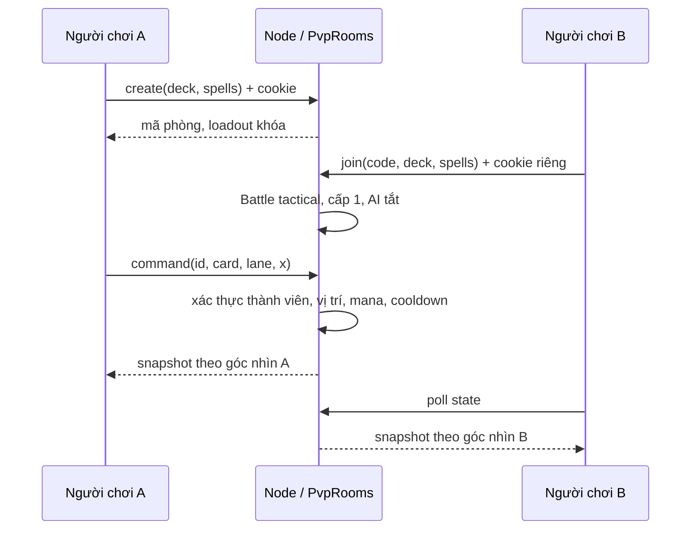

# Kora War — phân tích project và MVP Tactical Card Arena

> Tài liệu lịch sử ngày 13/10. Hiện trạng và ưu tiên mới: [khảo sát ngày 17/10/2026](PROJECT-AUDIT-2026-10-17.md), gồm catalog 14 tướng, cycle deck, ranked và đánh giá model/animation.

Ngày: 13/10/2026. Nguồn yêu cầu: `Game_desgin.md` và xác nhận trực tiếp của người dùng về MVP 4 tướng + 2 phép, mana 4, PvP chuẩn hóa. Các đoạn hướng phát triển Phase 2/3 trong tài liệu là lộ trình, không phải tính năng đã hoàn thành.

## 1. Hiện trạng trước triển khai

Project là một game có thể chơi được, không phải bộ khung: Three.js + TypeScript + Vite, fixed tick 20 Hz, 10 tướng có kỹ năng, ba lane, trụ, lõi, AI, mobile landscape, Content Studio, ví/thẻ và pipeline asset. Kiểm tra đầu phiên: `npm run check` thành công với 50 test, bao gồm golden fixture từ `e792b00`.

Kho có ba lớp runtime: trình duyệt; Node + SQLite cho content/economy; ASP.NET Core + PostgreSQL/object storage cho asset. Node đang sở hữu nghiệp vụ ví/trận. C# chưa phải game server. Các tài liệu nghiên cứu Castle Crush cũ cần đọc như lịch sử, không dùng để thay thế quyết định mới.

## 2. Phân tích từng phân hệ

| Phân hệ | Vai trò và luồng thực tế | Đánh giá / tác động của MVP |
|---|---|---|
| `src/main.ts` | Khởi tạo GameSession, sau đó nạp app | Offline vẫn có fallback; PvP cần API và cookie người chơi |
| `src/data` | Tướng, abilities, rules, traits, map, story, schema content/media và validator | Độc lập core/UI. Thêm catalog phép typed; không trộn thông số sát thương vào renderer |
| `src/core/Battle.ts` | Sở hữu tick, PRNG seed, quân/trụ/lõi, mana, cooldown, thống kê | Dùng chung ở client luyện tập và server PvP. Đường legacy bảo vệ replay/fixture cũ |
| `core/systems` | Validate/spawn, damage/heal, skills, mana, unit AI, towers, victory | Phép validate trước khi trừ mana; warning/DoT theo tick; tactical chọn slow mạnh nhất còn hiệu lực với thời hạn riêng, legacy giữ hành vi cũ |
| `core/ai` | Chấm lane bằng threat, front line, trụ và PRNG seed | AI luyện tập chọn phép khi có cụm địch, tuân thủ cùng cost/cooldown; PvP tắt AI |
| `core/physics` | Lane-space và giới hạn tọa độ triển khai | Phép được nhắm toàn lane trong x ±14; quân vẫn ở vùng triển khai của phe mình |
| `core/online-state.ts` | Đóng gói state cho client theo phe | Phe 1 đảo x và side để đội mình luôn bên trái; đổi cả trụ, events, stats, cooldown, spell zones; bản sao tách khỏi core |
| `src/app` | Điều phối input, UI, session, fixed-step và render | Luyện tập tự step; PvP chỉ nhận server state. Debug thay đổi trận bị khóa trong PvP |
| `src/engine` | Lifetime, pool, registry, pointer gesture | Một pointer sở hữu drag; cancel/blur/cleanup có kiểm thử. Không đặt luật vào đây |
| `src/rendering` | Camera, môi trường, GLB skeleton/animation, batching, sprite/audio event consumers | Đọc state; thêm vùng cảnh báo phép và dọn GPU resource khi hết hiệu lực/reset |
| `src/ui` | Sảnh, story, roster, settings, pause, result, economy | Sáu thẻ luôn hiện, chọn đúng hai phép, shortcut 1–6, lưu loadout; PvP không pause trận của đối thủ |
| `src/services` | Save migration, API, GameSession, audio, landscape | Save cũ tự nhận Lửa+Băng. PvP giữ mã phòng khi mất mạng tạm thời, retry cùng ID, bỏ packet cũ và hủy request khi rời phiên |
| `server/http.ts` | Gateway HTTP, origin/header, cookie auth, admin/player, static và asset | Thêm API PvP theo membership; không nhận side hay kết quả trận từ client |
| `server/pvp.ts` | Phòng chờ, loadout, server Battle, lệnh, thời gian, timeout | Một chủ sở hữu trận trong process; giới hạn 200 phòng, TTL, idempotency cache toàn trận, tối đa 2.048 lệnh mỗi phe |
| `server/game-service.ts` | Replay command log và reward economy | Thêm replay phép tactical; nhận dạng deck legacy và tactical; thưởng luyện tập vẫn transaction/idempotent |
| `server/database.ts` | SQLite WAL, published/draft/revision, session, ví/thẻ/ledger/audit | Không đổi schema phá dữ liệu. Tactical loadout dùng envelope JSON trong match deck hiện có |
| `src/admin` | Editor, preview, draft/publish/restore | Tiếp tục điều chỉnh content hiện có. Catalog phép MVP ở code; chưa có editor phép riêng |
| `server/assets*` và tools | Kiểm tra GLB/audio/image, provenance, SHA, import/sync/retry | Không thay pipeline hay nhập lại asset. Test ingestion/bridge hiện có tiếp tục chạy |
| `backend/KoraWar.AssetApi` | API nội bộ, token, PostgreSQL metadata, local/R2 object storage | Không thay nơi ghi ví/trận. Build riêng khi DLL của service đang chạy bị khóa |
| `tests` | node:test/tsx, fixtures, core, dịch vụ, backend, media/asset | Bổ sung kiểm thử phép, PvP identity/clock/mirroring/disconnect và HTTP hai người chơi |

## 3. Đối chiếu thiết kế

| Yêu cầu | Triển khai / quyết định |
|---|---|
| Ba lane, tự hành, phá nhà chính | Dùng core hiện có; trụ chặn đường tới lõi |
| Bốn nhân vật + hai phép luôn hiện | Roster, save, hand và server loadout đều hỗ trợ; không rút ngẫu nhiên |
| Gió, Lửa, Sét, Băng | Có cost/cooldown/vùng mục tiêu/cảnh báo/hiệu ứng; xem bảng dưới |
| Mana 4/10, ngân sách chung | Tactical bắt đầu 4; phép và tướng dùng cùng mana |
| PvP 1v1 chuẩn hóa | Phòng mời riêng, server-authoritative; chỉ số cấp 1 cho hai bên |
| Bốn vai trò chiến thuật | Tank: Brann/Kael; fighter: Solan; assassin: Nyx với tốc độ và Ám Kích; mage/marksman: Vesper/Orin/Lyra/Raiko. Giữ support và năm hệ hiện tại theo quyết định giữ catalog |
| Không RNG damage/chí mạng | Damage deterministic; PRNG chỉ dùng trong lựa chọn AI hiện có |
| Hệ/tộc kích hoạt trên sân | Giữ synergy theo deck theo quyết định giữ luật khác; chưa đổi sang đếm quân đang sống |
| Mục tiêu 4–6 phút | Là mục tiêu thiết kế, chưa được chứng minh bằng playtest. Giữ quá tải từ 180s nên trận có thể ngắn hơn |
| Rank cao draft/ban, combo, thêm phép, season | Ngoài MVP đã chọn; thuộc Phase 2/3 |

### Thông số phép MVP

| Phép | Mana | Hồi | Bán kính theo lane | Cảnh báo | Hiệu ứng |
|---|---:|---:|---:|---:|---|
| Gió | 2 | 8s | 2,8 | 0,25s | 20 damage, đẩy địch 2m, kẹp trong sân |
| Lửa | 4 | 12s | 2,5 | 0,7s | 45 damage/s × 3s, quân ra/vào vùng được xét từng tick |
| Sét | 4 | 12s | 2,2 | 0,65s | 110 damage, choáng 0,6s; không cộng dồn thời gian stun đang có |
| Băng | 3 | 10s | 2,8 | 0,4s | 35 damage, slow 40% trong 2s; không cộng phần trăm slow |

Đây là thông số triển khai ban đầu để playtest, không phải kết quả cân bằng thi đấu. Phép MVP tác động quân địch, không gây damage lên công trình; Động đất trong thiết kế là phép giai đoạn sau.

## 4. Luồng PvP

Core tiến đến số tick tương ứng thời gian server khi có poll/lệnh, không dựa vào tick client. Đồng hồ đơn điệu tránh ảnh hưởng khi đổi giờ hệ thống; catch-up dừng tại deadline mất kết nối đầu tiên hoặc tick kết thúc trận nếu xảy ra sớm hơn. Poll mặc định khoảng 100ms; không giả lập rằng đó là WebSocket. Hai client nhận cùng một trận và bản sao content/loadout tách khỏi phòng. Browser reload dùng mã phòng trong sessionStorage cùng cookie để vào lại; tab mới có thể tìm phòng hiện hành bằng cookie qua `/api/pvp/current`. Mã lưu đã hết hạn được thay bằng phòng hiện hành nếu có; lỗi mạng tạm thời giữ mã để reconnect. Tạo phòng khi đã có phòng trả lại loadout khóa hiện tại. Sau 30s không liên lạc, phe mất kết nối bị xử thua. Phòng chờ hết hạn 10 phút; kết quả giữ tối đa 5 phút tính từ thời điểm kết thúc thực tế trước lần dọn tiếp theo. Phòng bỏ dở được thu hồi khi có thao tác tiếp theo. Khởi động lại process mất phòng.

## 5. Các lỗi và điểm thiếu đã xử lý

- Thiếu phép, loadout sáu thẻ, mana 4 và PvP: bổ sung xuyên suốt data → core → server → app → UI/renderer.
- Level cũ gây khác biệt sức mạnh: tactical bỏ level multiplier, giao diện kho nói rõ cấp sưu tập không tăng chỉ số trận.
- Phe thứ hai triển khai bên phải theo tọa độ server: transform view và lệnh theo membership; UI hai phía cùng thao tác bên trái.
- Snapshot đến trễ có thể ghi đè lệnh mới: server version tăng dần, client bỏ packet cũ.
- Phòng hết hạn hoặc quyền truy cập đã mất: xóa session local và cho trở lại sảnh; leave vẫn hoạt động khi request thất bại. Lỗi mạng/server tạm thời giữ mã phòng và tiếp tục thử kết nối.
- Pause/ẩn tab trong PvP: không tạm dừng simulation server; menu giải thích đầu hàng. Kết quả PvP không tăng lặp bộ đếm thắng luyện tập khi reload.
- FPS từ tab bị throttling làm hạ đồ họa sai: bỏ frame ẩn và khoảng frame quá dài khỏi quyết định tự hạ quality.
- CSS mobile cũ tạo tràn ngang ở sảnh/roster nhỏ: reset action panel và dùng cột roster có thể co; kho trên màn nhỏ gộp truy cập qua nút vàng để tránh che nút PvP.
- Phòng còn sống nhưng tab mới không có mã: tra phòng theo cookie; tạo lại không làm mất loadout đã khóa. Phòng đã hết trận không chặn tạo phòng mới.
- Phản hồi open/command đến sau khi rời phòng hoặc HMR: generation vô hiệu phản hồi cũ trước khi leave hoàn tất. Mã lệnh trùng được giữ toàn trận thay vì xóa sau 256 lệnh.
- Save thiếu hoặc chứa phép không hợp lệ: fallback hai phép mặc định; giữ deck/wins/settings cũ.
- Build C# bị khóa DLL đang chạy: kiểm tra bằng output riêng trong cache, không dừng Asset API đang dùng.

Đợt ổn định tiếp theo ngày 13/10/2026 đã xử lý thêm:

- Lửa nhận thêm một tick sát thương tại một số thời điểm cast do sai số số thực: thêm tolerance ở biên hết hạn; kiểm thử mọi cast tick trong 6 phút và các offset lớn giữ đúng 60 tick / 135 sát thương.
- Đòn Băng Thệ làm yếu Băng hoặc kỹ năng slow đang mạnh hơn: lưu thời hạn theo mức làm chậm, chọn mức mạnh nhất còn hiệu lực và chuyển về mức yếu còn thời gian khi mức mạnh hết hạn, theo quyết định người dùng. Legacy không đổi.
- Mất phản hồi sau khi server đã áp dụng lệnh PvP: client thử lại một lần với cùng ID; server trả kết quả đã lưu, không gọi quân hoặc trừ mana thêm. Lệnh bị từ chối không tự thử lại.
- Restore gặp mã phòng cũ hoặc mạng tạm mất: tra phòng hiện hành theo cookie khi mã hết hạn, giữ mã khi lỗi mạng; thông báo mất/kết nối lại và hủy request đang chờ khi dispose.
- Timeout phòng được quan sát muộn: xử lý theo thứ tự thời gian, dừng combat tại deadline đúng, tính TTL từ kết thúc thực tế và thu hồi phòng bỏ dở để trả sức chứa. Bản sao snapshot không cho sửa content/loadout/state của phòng.
- Vòng nhắm phép chung nhỏ hơn vùng tác động: preview dùng bán kính và màu riêng của Gió/Lửa/Sét/Băng, cùng chiều rộng lane với warning; vòng tướng/Cộng Hưởng giữ nguyên.
- Phản hồi triển khai PvP chậm xóa thẻ mới vừa chọn: revision selection bảo vệ lựa chọn mới; phản hồi của phiên đã rời không đổi giao diện trận khác.
- Trong khi leave đang chờ, UI có thể gửi thêm lệnh: khóa command/open/restore tới khi leave hoàn tất, gộp leave đồng thời và chặn finally của leave cũ xóa phiên mới. CSS mobile giới hạn nhóm nút lane và banner reconnect để không che sân/thông báo.

## 6. Kiểm chứng và phạm vi tin cậy

Chi tiết kết quả cuối cùng được ghi tại `docs/06-implementation/qa.md`. Bộ golden hash legacy giữ nguyên. Kiểm thử mới kiểm tra tính nguyên tử của lệnh sai, mana/cooldown, warning/DoT/control, replay luyện tập, seeded determinism, phòng hai danh tính, chống outsider/cross-origin, mirrored state, duplicate command và disconnect.

Sau đợt ổn định, `npm run check` hoàn tất với **98/98 test đạt**, kiểm tra ranh giới kiến trúc, TypeScript server/client và production build Vite đều đạt. Các test bổ sung kiểm tra DoT ở biên tick, slow mạnh/yếu hết hạn độc lập, preview bằng bounding box, retry sau khi server đã áp dụng lệnh, restore, leave đang chờ và vòng đời phòng. Cảnh báo bundle Three.js vượt 500 kB vẫn còn; đây không phải số đo hiệu năng thiết bị.

QA trình duyệt dùng Edge và Chrome với profile riêng: lưu bộ phép, tạo/vào cùng phòng, 4 mana, triển khai quân hai phía, cast Lửa, reload reconnect, đầu hàng và đối thủ thắng. Kiểm tra viewport ngang 844×390 là giả lập kích thước trên desktop, không phải benchmark điện thoại.

## 7. Giới hạn còn lại

- Phòng mời một process đã chơi được; chưa có hạ tầng Internet/HTTPS, matchmaking, tài khoản liên thiết bị, ranked hoặc thử tải nhiều người thật.
- Reconnect cùng cookie và process đang sống; chưa persist active room qua restart. Không thưởng vàng PvP để tránh đưa economy chưa được thiết kế vào đối kháng.
- Chỉ số phép cần playtest cân bằng; cơ chế combo nguyên tố và draft/ban chưa triển khai.
- Nyx dùng kỹ năng và targeting hiện có; chưa có cơ chế nhảy thẳng vào hậu tuyến riêng. Đây là phần có thể mở rộng khi duyệt thay đổi bộ kỹ năng tướng.
- Chưa kiểm thử cảm ứng và GPU trên iOS/Android vật lý, mạng WAN độ trễ cao hoặc R2 thật.
- Bundle Three.js vẫn vượt ngưỡng cảnh báo 500 kB của Vite. Không coi cảnh báo kích thước hay FPS runtime là benchmark sản phẩm.
- Content Studio chưa sửa catalog phép; thay thông số phép cần sửa `src/data/spells.ts` và chạy test.

Không có cơ sở để cam kết “không còn mọi lỗi”. Kết quả bàn giao là MVP đã được kiểm thử theo các trường hợp cụ thể ở trên, kèm giới hạn có thể tái kiểm tra.
